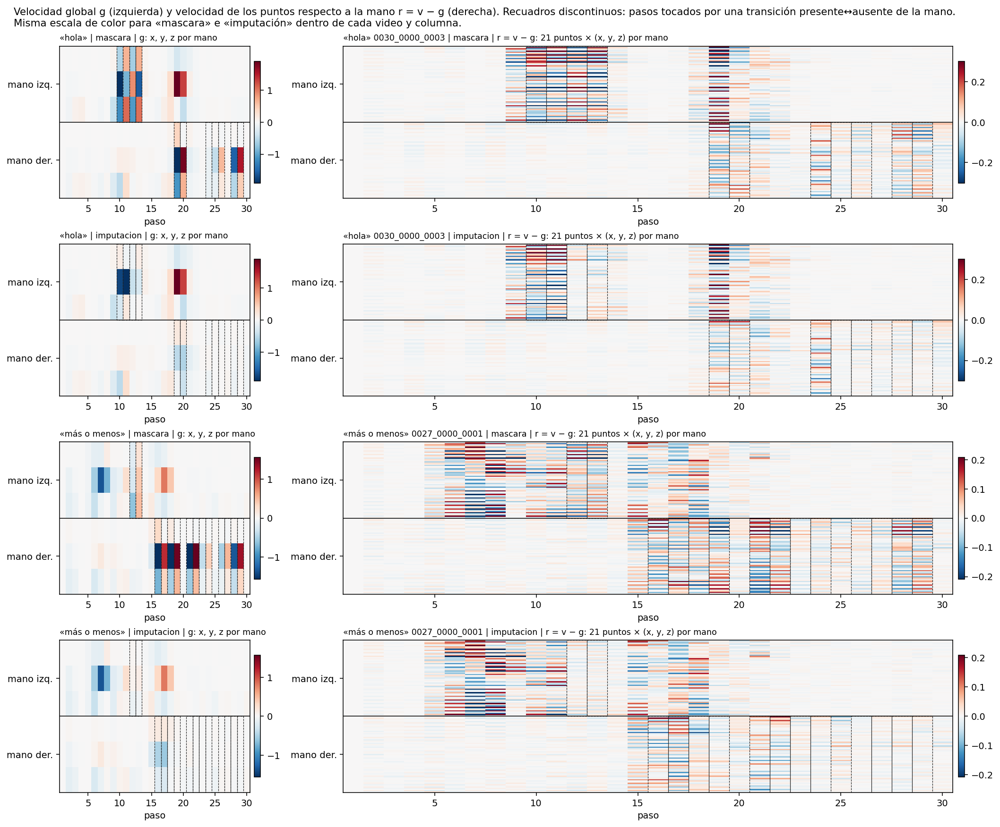

# Experimento explicativo: ¿por qué 6 velocidades bastan con «mascara» y no con imputación?

Fecha: 3 de octubre de 2026. **Experimento EXPLICATIVO, no de adopción.** No cambia el modelo canónico, el
umbral ni `translator.py`, y su resultado no elige configuración.

**Antecedente** (`docs/EXPERIMENTO_FACTORIAL_TCN.md`, TCN `CONFIG_T`, medias de 3 semillas × 5 pliegues):

| preprocesamiento | velocidades | validación | `val_loss` | prueba |
|---|---|---:|---:|---:|
| mascara | 252 (126 pos + 126 vel) — T0 | 0,949 | 0,992 | 0,651 |
| mascara | 132 (126 pos + 6 vel: media por mano y eje) — T3 | 0,941 | 0,997 | 0,654 |
| imputación | 252 — T1 | 0,949 | 0,978 | 0,677 |
| imputación | 132 — T2 | 0,945 | 0,990 | 0,653 |
| pivote | 252 — T4 | 0,956 | 0,954 | 0,670 |
| pivote | 132 — T5 | 0,949 | 0,977 | 0,656 |

Con imputación, la persona 0000 baja de 0,488 (252) a 0,408 (132). Las 6 velocidades conservan ~96-97 % de la
energía de las 126 (`docs/EXPERIMENTO_VELOCIDADES_REDUCIDAS.md`).

## Hipótesis

1. Promediar las 21 velocidades de una mano conserva el movimiento **global** de la mano y borra el movimiento
   **relativo** de los dedos (abrir o cerrar la mano, doblar dedos). Ese movimiento es pequeño en energía pero
   discriminativo.
2. Con «mascara», las velocidades por punto están dominadas por **saltos falsos** (la mano cae a 0 y vuelve), que
   tapan el componente de los dedos. Por eso reducirlas no cambiaba nada con «mascara» y sí empeora con
   imputación.

---

## 1. Diseño (fijado antes de las corridas)

Por mano y en cada paso: v_i = velocidad del punto i (i = 0..20; la de `add_velocity`), **g** = media de las 21
v_i (3 valores), **r_i** = v_i − g (63 valores). Como Σ r_i = 0, Σ‖v_i‖² = 21‖g‖² + Σ‖r_i‖² exactamente. Las 6
columnas de g son exactamente las de «por_coordenada» (T2, T3). Código: `src/velocidad_dedos.py`.

Todos los brazos usan la TCN (`CONFIG_T` exacta) con la receta de la confirmación (Adam 1e-3 con CosineDecay,
*label smoothing* 0,1, lote 64, paciencia 25 sobre `val_accuracy`, máx. 200 épocas), aumentación ×10, 30 pasos,
`data/processed_holistic_mascara_rostro`, «manos», LOSO de 5 pliegues (D-06), semillas 2026, 2027 y 2028. Todas
las velocidades (v, g, r) se calculan **después** de la aumentación y del remuestreo (la función de entrada
sustituye a `add_velocity` en la tupla `canon`), como en los experimentos previos.

| Brazo | Mano ausente | Entrada | Rasgos | Parámetros | Origen |
|---|---|---|---:|---:|---|
| T0 | mascara | 126 pos + 126 v | 252 | 156.402 | reutilizado (`arquitecturas_literatura_2026-10-02/T_tcn`) |
| T3 | mascara | 126 pos + g (6) | 132 | 125.682 | reutilizado (`factorial_tcn_2026-10-03`) |
| T1 | imputación | 126 pos + 126 v | 252 | 156.402 | reutilizado (`confirmacion_tcn_2026-10-03`) |
| T2 | imputación | 126 pos + g (6) | 132 | 125.682 | reutilizado (`confirmacion_tcn_2026-10-03`) |
| T4, T5 | pivote | 252 / 132 | | | reutilizados, solo descriptivos |
| **H1** | imputación | 126 pos + g (6) + r (126) | 258 | 157.938 | **nuevo** — control: reparametrización lineal de T1 |
| **H2** | imputación | 126 pos + r (126) | 252 | 156.402 | **nuevo** — sin velocidad global |
| **H3** | mascara | 126 pos + r (126) | 252 | 156.402 | **nuevo** |

Predicciones: H1 ≈ T1 (misma información). Hipótesis 1: H2 ≈ T1 y mejor que T2. Hipótesis 2: H3 no mejora a T3.

Script: `src/experimento_hipotesis_velocidad_dedos.py` (entrena con `experimento_arquitecturas.entrenar_corrida`,
constructor «T»; reutiliza σ agrupada, Δ por pliegue, voto de semillas, McNemar y pruebas pareadas de los scripts
anteriores). Pruebas: `tests/test_hipotesis_velocidad_dedos.py`. Modelos: `models/hipotesis_velocidad_dedos_2026-10-03/`.

**Verificaciones antes de las corridas completas:** configuración de las 90 corridas reutilizadas; entradas
(«actual» = `add_velocity`, g = «por_coordenada», v = g + r, Σ r = 0, posiciones intactas); **espejo** con los
datos reales (espejar las posiciones y después calcular la entrada debe dar: manos intercambiadas, g_x y r_x con
el signo cambiado); parámetros; **reproducción byte a byte de T1 (semilla 2026, pliegue 0)** con la ruta de
entrada de este script; prueba de humo en el *carpeta_temporal*.

## 2. Análisis sin entrenamiento (997 videos, entrada de 30 pasos, sin aumentar)

- **Fracción de energía**: 21‖g‖² frente a Σ‖r_i‖² sobre la energía total de las velocidades (pasos 2-30, ambas
  manos), con «mascara» y con imputación.
- **Saltos falsos**: *paso de transición* = paso t cuya velocidad mezcla fotogramas originales con la mano y sin
  ella (entre los fotogramas que intervienen con peso > 0 en los pasos t−1 y t hay al menos uno con la mano
  detectada y uno sin ella). Se define sobre los fotogramas originales, así que son **los mismos pasos** para
  «mascara» y para imputación. Se mide qué fracción de la energía de r cae en esos pasos. Se informa también la
  definición amplia de `docs/EXPERIMENTO_VELOCIDADES_REDUCIDAS.md` (en t o t−1 interviene algún fotograma sin la
  mano).
- **Sonda lineal**: por video, media y desviación temporal (pasos 2-30) de cada columna. Conjuntos: **g** (12
  rasgos), **r** (252), **r_12** (por mano y eje, la raíz cuadrática media de r sobre los 21 puntos; media y DE →
  12 rasgos, para separar información de dimensión), **g+r** (264) y **v** (252). Regresión logística multinomial
  sobre rasgos estandarizados con el entrenamiento; por pliegue LOSO se ajusta con *train*, C ∈ {0,001, 0,01, 0,1,
  1, 10, 100} se elige por exactitud en la validación interna (empate: menor log-loss) y se evalúa una vez en el
  señante excluido. Azar = 0,02.
- **Figura**: mapas de color de g (30 × 6) y r (30 × 126) con «mascara» y con imputación, para «hola»
  (0030_0000_0003) y para una seña con cambio de configuración de la mano, elegida con los datos: la clase con la
  mayor fracción mediana de energía relativa con imputación; de ella, el video de la persona 0000 más cercano a
  esa mediana. Sin personas del corpus. `docs/figuras_2026-10-03/`.

## 3. Criterio prerregistrado (escrito el 3-oct-2026 a las 02:34, antes de las corridas completas y del análisis)

**Métricas de validación** (la exactitud está saturada): top-1 de validación y `val_loss` (entropía cruzada con
*label smoothing* 0,1 del *checkpoint* recargado, la que guarda `entrenar_corrida`). Comparaciones con la media de
3 semillas por pliegue y su media sobre los 5 pliegues.

**Márgenes.** σ entre semillas agrupada (raíz de la media de las varianzas, entre semillas, de la media de 5
pliegues) sobre los 7 brazos T0, T3, T1, T2, H1, H2, H3. Margen top-1 = máx(σ_top1, 0,01). Margen `val_loss` =
σ_val_loss (sin piso). Δ top-1 = A − B; Δ `val_loss` = A − B (negativo = A mejor).

**Hipótesis 1**
- **CONFIRMADA** si se cumplen las tres:
  - (a) H2 no es peor que T1: Δ top-1 (H2 − T1) ≥ −margen y Δ `val_loss` (H2 − T1) ≤ +margen;
  - (b) H2 tiene menor `val_loss` que T2 en ≥ 4 de 5 pliegues;
  - (c) sonda lineal con imputación: la sonda sobre **r** (252 rasgos) tiene top-1 LOSO medio ≥ 0,10 (5 × azar) y
    ≥ 0,5 × el de la sonda sobre **g** (12 rasgos).
- **REFUTADA** si H2 es peor que T2 (Δ top-1 (H2 − T2) < −margen o Δ `val_loss` (H2 − T2) > +margen) o peor que
  T1 por más del margen (falla (a)).
- **NO CONCLUYENTE** en cualquier otro caso.

**Hipótesis 2**
- **CONFIRMADA** si (e1) con «mascara» ≥ 50 % de la energía de r cae en pasos de transición, (e2) con imputación
  la fracción en esos mismos pasos es a lo sumo la mitad de la de «mascara», y H3 **no supera** a T3 por más del
  margen (ni Δ top-1 (H3 − T3) > margen, ni reducción de `val_loss` (T3 − H3) > margen de `val_loss`).
- **REFUTADA** si falla (e1) o si H3 supera a T3 por más del margen.
- **NO CONCLUYENTE** en otro caso (se cumple (e1), falla (e2) y H3 no supera a T3).

**Control H1.** Se espera H1 ≈ T1: |Δ top-1| ≤ margen y |Δ `val_loss`| ≤ margen. Si no se cumple, se investiga
(problema de implementación o sensibilidad de la red a la parametrización) antes de interpretar H2.

**Prueba LOSO** (top-1, top-3, F1 macro, persona 0000, McNemar de la semilla 2026 y del voto de 3 semillas,
pruebas de signos y de Wilcoxon por pliegue, con p mínimo 0,0625 en 5 pliegues): **descriptiva**, no cambia el
veredicto. Si contradice al veredicto de validación, se dice.

---

## 4. Verificación y prueba de humo (3-oct, 02:34 a 02:37)

- **Configuración**: las 90 corridas reutilizadas (T0-T5) tienen `CONFIG_T`, la receta común, 200 épocas,
  paciencia 25, aumentación ×10, 30 pasos, el *processed* canónico, «manos» y la regla y la entrada de su brazo.
- **Entradas**: «actual» = `add_velocity` bit a bit; g = «por_coordenada» (máx. |dif| 7·10⁻⁷, orden de la suma);
  v = g + r (máx. |dif| 6·10⁻⁸); Σ r = 0 por mano; posiciones intactas. Parámetros: 156.402 con 252 rasgos y
  157.938 con 258.
- **Espejo** con los datos reales (los 1000 videos del *processed*, «mascara» e imputación): espejar las
  posiciones y después calcular la entrada da exactamente (|dif| = 0) la entrada esperada: manos intercambiadas,
  g_x y r_x con el signo cambiado, g_y, g_z, r_y y r_z iguales.
- **Reproducción de T1 (semilla 2026, pliegue 0)** con la ruta de entrada de este script (02:36:56, corrida nueva
  en el *carpeta_temporal*): `predicciones.json` idéntico byte a byte, historial idéntico, misma `val_loss` (0,87012),
  probabilidades de validación y prueba idénticas (|dif| = 0). Ver anomalía 1 (§8).
- **Prueba de humo** (3 épocas; `models/hipotesis_velocidad_dedos_2026-10-03/humo.json`): H1, H2 y H3 se guardan,
  se recargan con entrada 30 × 258, 30 × 252 y 30 × 252, con los parámetros esperados y la procedencia corregida.
- Corridas completas: 3 procesos (uno por semilla), 02:37 a 03:09, sin otros entrenamientos activos.

## 5. Análisis sin entrenamiento (997 videos; `models/hipotesis_velocidad_dedos_2026-10-03/analisis.json`)

### 5.1 Fracción de energía y saltos falsos

Pasos 2-30, ambas manos. Los pasos de transición son el **9,1 %** de los pasos-mano (izquierda 11,4 %, derecha
6,7 %).

| | mascara | imputación |
|---|---:|---:|
| energía total de las velocidades | 238.655 | 131.499 |
| fracción global (21‖g‖²) | **96,9 %** | **95,3 %** |
| fracción relativa (Σ‖r_i‖²) | **3,1 %** | **4,7 %** |
| energía de r (absoluta) | 7.387 | 6.248 |
| fracción de la energía de **r** en pasos de transición | **37,7 %** | **26,0 %** |
| fracción de la energía de **g** en pasos de transición | **62,3 %** | 30,0 % |
| energía de g en pasos de transición (absoluta) | 144.170 | 37.551 |
| energía de r en pasos de transición (absoluta) | 2.786 | 1.626 |
| definición amplia («artificial»): fracción de r | 37,7 % | 26,4 % |

Comprobación: fuera de los pasos «artificiales», las velocidades de «mascara» e imputación son idénticas
(|dif| = 0).

**Lectura.** Los saltos falsos de «mascara» van casi todos a **g**, no a r: añaden unas 107.000 unidades de
energía a g en los pasos de transición y solo unas 1.200 a r. Cuando la mano «cae» a 0, todos sus puntos saltan
juntos hacia el origen; ese salto es sobre todo traslación (g) y, en r, solo aparece la forma de la mano
encogiéndose. Con imputación, los pasos de transición también concentran energía (26 % de r y 30 % de g en el
9 % de los pasos): la mano se pierde justamente cuando se mueve rápido, así que esos pasos son de movimiento real.

### 5.2 ¿Qué es r? Giro y escala frente a deformación (descriptivo, añadido tras el prerregistro)

Ajuste por mínimos cuadrados r_i ≈ ω × d_i + s·d_i (giro pequeño + escala aparente; d_i = posición del punto
respecto al centroide de la mano; `velocidad_dedos.descomponer_r_rigida`). El residuo es deformación (dedos que se
doblan, mano que se abre o se cierra).

| | fuera de transiciones | en transiciones |
|---|---:|---:|
| mascara: giro + escala / deformación | 42 % / 58 % | **85 %** / 15 % |
| imputación: giro + escala / deformación | 42 % / 58 % | 42 % / 58 % |

Fuera de las transiciones, algo más de la mitad de r es deformación de la mano y el resto es giro de la muñeca (y
cambio de tamaño aparente). En las transiciones de «mascara», r es casi solo «escala»: la mano encogiéndose hacia
el origen. Así que r no es solo «dedos»: es todo lo que la mano hace aparte de trasladarse.

### 5.3 Sonda lineal (regresión logística, LOSO, C elegido en la validación interna; azar = 0,02)

Top-1 en el señante excluido, media de los 5 pliegues (DE entre pliegues):

| rasgos (media y DE temporal) | n | mascara | imputación |
|---|---:|---:|---:|
| g | 12 | 0,066 (0,039) | 0,109 (0,048) |
| **r** | 252 | **0,304** (0,165) | **0,302** (0,136) |
| r_12 (RMS de r por mano y eje) | 12 | 0,115 (0,023) | 0,141 (0,036) |
| g + r | 264 | 0,310 (0,169) | 0,334 (0,173) |
| v (126 velocidades) | 252 | 0,238 (0,129) | 0,272 (0,139) |

r tiene información discriminativa muy por encima del azar (15 veces) y más que g, incluso con el mismo número de
rasgos (r_12: 0,141 frente a 0,109 con imputación). Con «mascara», g pierde casi todo su valor lineal (0,066,
3 veces el azar): está dominado por los saltos falsos. r conserva el mismo valor con las dos reglas.

### 5.4 Figura

`docs/figuras_2026-10-03/velocidad_dedos_g_r_hola_0030_0000_0003_y_0027_0000_0001.png` (solo números, sin
personas; datos en `velocidad_dedos_figura.json`). Segunda seña: **«más o menos» (0027_0000_0001)**, elegida con la
regla prerregistrada: es la clase con la mayor fracción mediana de energía relativa con imputación (13,8 %; le
siguen «¿cómo?» 11,8 %, «hambre» 9,3 %, «¿dónde?» 9,0 % y «seña» 7,4 %). En este video, fuera de las transiciones,
el 64 % de r es deformación (en «hola», el 74 %). No se comprobó la forma de la seña en el video: es probable que
parte de su r sea giro de la muñeca y no solo cambio de configuración.

Lo que se ve: con «mascara», g muestra franjas intensas de signo alterno en los pasos de transición (la mano izq.
de «hola» en los pasos 10-13; la mano der. de «más o menos» en 16-29), que con imputación desaparecen o se
suavizan. r, en cambio, se parece mucho con las dos reglas: los patrones fuertes de r (mano izq. de «más o menos»
en los pasos 5-9 y 14-18, sin transiciones) son movimiento real de la mano respecto a sí misma, y g casi no los
registra.

---

## 6. Resultados de las corridas (`docs/EXPERIMENTO_HIPOTESIS_VELOCIDAD_DEDOS.json`)

Medias de 3 semillas × 5 pliegues. «0000» = top-1 de prueba del pliegue 0 (persona 0000).

| Brazo | Entrada | Validación top-1 | `val_loss` | Prueba top-1 | Top-3 | F1 macro | 0000 | Voto 3 sem. |
|---|---|---:|---:|---:|---:|---:|---:|---:|
| T0 | mascara, 126 pos + v | 0,9487 | 0,9916 | 0,6510 | 0,8198 | 0,6190 | 0,465 | 0,687 |
| T3 | mascara, 126 pos + g | 0,9413 | 0,9975 | 0,6543 | 0,8222 | 0,6241 | 0,480 | 0,694 |
| **H3** | mascara, 126 pos + r | 0,9500 | 0,9809 | **0,6814** | 0,8416 | **0,6501** | **0,542** | 0,716 |
| T1 | imputación, 126 pos + v | 0,9493 | 0,9776 | 0,6771 | 0,8466 | 0,6467 | 0,488 | 0,716 |
| T2 | imputación, 126 pos + g | 0,9447 | 0,9899 | 0,6527 | 0,8346 | 0,6216 | 0,408 | 0,690 |
| **H1** | imputación, 126 pos + g + r | 0,9527 | 0,9779 | 0,6677 | 0,8356 | 0,6349 | 0,428 | 0,711 |
| **H2** | imputación, 126 pos + r | 0,9507 | 0,9818 | 0,6741 | 0,8476 | 0,6394 | 0,443 | 0,704 |
| T4 | pivote, 252 (descr.) | 0,9560 | 0,9538 | 0,6698 | 0,8450 | 0,6388 | 0,457 | 0,702 |
| T5 | pivote, 132 (descr.) | 0,9487 | 0,9766 | 0,6563 | 0,8189 | 0,6283 | 0,427 | 0,687 |

**Márgenes.** σ_top1 agrupada = 0,0085 → margen top-1 = **0,010**. σ_val_loss agrupada = **0,0253** (la domina
T2, cuya `val_loss` varía mucho entre semillas: DE 0,049).

`val_loss` por pliegue (media de semillas), pliegues 0 a 4:

| | 0 | 1 | 2 | 3 | 4 |
|---|---:|---:|---:|---:|---:|
| T1 | 0,897 | 1,012 | 1,046 | 0,920 | 1,013 |
| T2 | 0,914 | 1,045 | 1,042 | 0,888 | 1,060 |
| H1 | 0,930 | 1,001 | 1,027 | 0,902 | 1,029 |
| H2 | 0,863 | 1,011 | 1,041 | 0,996 | 0,998 |
| T3 | 0,934 | 1,026 | 1,053 | 0,928 | 1,047 |
| H3 | 0,952 | 0,983 | 1,007 | 0,931 | 1,032 |

### 6.1 Control H1 ≈ T1

Δ top-1 (H1 − T1) = +0,0033 (por pliegue +0,007 / +0,003 / +0,003 / 0 / +0,003); Δ `val_loss` = +0,0003. **H1 ≈ T1
en validación**: la descomposición está bien implementada. En prueba, H1 queda algo por debajo (0,668 frente a
0,677; persona 0000: 0,428 frente a 0,488); McNemar de la semilla 2026 p = 0,008 a favor de T1, pero con el voto
de 3 semillas p = 0,74 (709 frente a 714 aciertos). Es variación entre semillas, no un problema de implementación
(v = g + r se comprueba a 6·10⁻⁸).

### 6.2 Hipótesis 1: **CONFIRMADA** (con evidencia de validación débil)

- (a) H2 frente a T1: Δ top-1 = +0,0013 (≥ −0,010) y Δ `val_loss` = +0,0041 (≤ +0,0253). **Cumple.**
- (b) H2 frente a T2: `val_loss` menor en **4 de 5** pliegues (−0,050 / −0,034 / −0,001 / **+0,108** / −0,062;
  media −0,008). **Cumple.**
- (c) Sonda con imputación: r 0,302 ≥ 0,10 y ≥ 0,5 × g (0,109). **Cumple.**
- H2 no es peor que T2 (Δ top-1 +0,006; Δ `val_loss` −0,008) ni que T1 por más del margen.

Matiz: la mejora de H2 sobre T2 en `val_loss` (0,008) es mucho menor que σ (0,025), y la validación apenas
distingue T1 de T2 (0,978 frente a 0,990). El veredicto descansa en (b) (cuenta de pliegues) y en la sonda.

**Prueba LOSO (descriptiva), de acuerdo con el veredicto.** Quitar g y dejar r (H2) recupera casi toda la
ventaja de T1 sobre T2: prueba 0,674 frente a 0,677 (T1) y 0,653 (T2); F1 0,639 frente a 0,647 y 0,622. H2 frente
a T2: mejor en 4 de 5 pliegues (signos p = 0,375; Wilcoxon p = 0,125); McNemar semilla 2026 p = 0,12, voto
p = 0,24. H2 frente a T1: sin diferencia (McNemar 2026 p = 1). La persona 0000 se recupera solo en parte (0,443
frente a 0,488 de T1 y 0,408 de T2).

### 6.3 Hipótesis 2: **REFUTADA**

- (e1) Con «mascara», la fracción de la energía de r en pasos de transición es **37,7 % < 50 %**. Falla.
- (e2) Con imputación, 26,0 %: no es a lo sumo la mitad (18,9 %). Falla.
- H3 frente a T3: Δ top-1 = +0,0087 (< 0,010) y reducción de `val_loss` = 0,0166 (< 0,0253): H3 no supera a T3
  por más del margen en validación.

El veredicto prerregistrado es REFUTADA porque falla (e1). El mecanismo de la hipótesis está al revés: los saltos
falsos de «mascara» contaminan sobre todo **g** (62 % de la energía de g en el 9 % de los pasos; sonda lineal de g
con «mascara» 0,066), no r.

**La prueba LOSO contradice la parte «H3 no mejora a T3».** Con «mascara», quitar g y dejar r (H3) da el **mejor
resultado de prueba de todos los brazos**: 0,681 (T3 0,654, T0 0,651), F1 0,650, persona 0000 **0,542** (T3 0,480,
T0 0,465). H3 frente a T3: F1 mejor en los 5 pliegues (signos y Wilcoxon p = 0,0625, el mínimo posible); McNemar
semilla 2026 p = 0,0003, voto p = 0,059. H3 frente a T0: top-3 mejor en 5 de 5 (p = 0,0625); McNemar voto
p = 0,013. La validación (saturada) no lo detecta por más del margen. Es descriptivo y no cambia el veredicto.

## 7. Explicación simple

La velocidad de cada mano se puede partir en dos: cuánto se desplaza la mano entera (g) y cómo se mueven sus
puntos respecto a la propia mano (r: dedos que se doblan, mano que se abre, muñeca que gira). r es poquita energía
(3-5 %), pero sirve mucho para reconocer señas: una regresión lineal con solo r acierta el 30 % de las señas de una
persona nueva, frente al 11 % con g. Por eso, al dejar solo las 6 medias (g), se pierde información útil, y la red
con r recupera lo que la de g perdía. Con «mascara», el problema no está en r: cuando la mano desaparece, «salta» al
punto 0 (entre los hombros) y ese salto falso cae casi entero en g. Por eso, con «mascara», usar g o las 126 velocidades da
lo mismo (ambas llevan el salto falso), y quitar g y dejar r da el mejor resultado en prueba, aunque la
validación, saturada, no alcance a confirmarlo.

## 8. Anomalías

1. **Primera reproducción inválida, corregida.** El *carpeta_temporal* es compartido con el experimento factorial: la
   primera `verificar --dest .../repro_t1` encontró una carpeta de reproducción anterior (de
   `experimento_factorial_tcn`, 01:43) y la comparó sin reentrenar. Se detectó al ver la fecha; se detuvieron las
   3 corridas propias recién lanzadas (≈ 1 min, sin ningún `resultado.json`), se borraron sus carpetas vacías, se
   reprodujo T1 con este script en una carpeta nueva (`repro_t1_hvd`, 02:36:56, byte a byte) y se relanzó.
2. **H1 algo peor que T1 en prueba con la semilla 2026** (McNemar p = 0,008), no con el voto (p = 0,74); persona
   0000 0,428 frente a 0,488. Validación equivalente. Indica cierta sensibilidad de la red a la parametrización (la
   raíz cuadrática media de cada columna de r es ~5 veces menor que la de v y no hay normalización de la entrada), no un error.
3. **Pliegue 3 (persona 0003)**: H2 tiene `val_loss` 0,996, bastante peor que T1 (0,920) y T2 (0,888); es el único
   pliegue en contra en (b). En prueba ese pliegue empata (0,773 frente a 0,770 y 0,775).
4. **σ de `val_loss` dominada por T2** (DE entre semillas 0,049, frente a 0,002-0,028 del resto): el margen de
   `val_loss` (0,025) es holgado.
5. Con imputación, los pasos de transición también concentran energía (26 % de r y 30 % de g en el 9 % de los
   pasos): la mano suele perderse cuando se mueve rápido. Por eso (e2) falla: la definición de «paso de transición»
   no aísla solo artefactos.
6. La descomposición giro/escala/deformación (§5.2) se añadió después del prerregistro; es descriptiva.

## 9. Archivos

- Código: `src/velocidad_dedos.py`, `src/experimento_hipotesis_velocidad_dedos.py`; pruebas:
  `tests/test_hipotesis_velocidad_dedos.py` (23 pruebas, solo NumPy).
- Modelos y registros: `models/hipotesis_velocidad_dedos_2026-10-03/` (H1, H2, H3 × 3 semillas × 5 pliegues;
  `verificacion.json`, `humo.json`, `analisis.json`, `resultados_hipotesis_velocidad_dedos.json`, logs).
- Datos crudos: `docs/EXPERIMENTO_HIPOTESIS_VELOCIDAD_DEDOS.json`.
- Figura: `docs/figuras_2026-10-03/velocidad_dedos_g_r_hola_0030_0000_0003_y_0027_0000_0001.png` y
  `velocidad_dedos_figura.json`.
