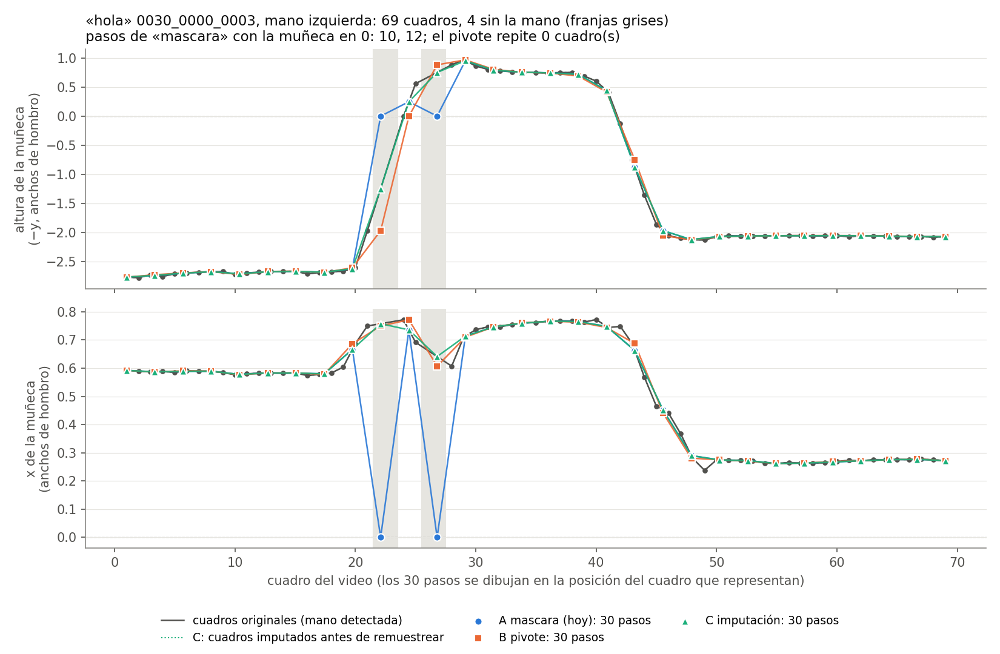
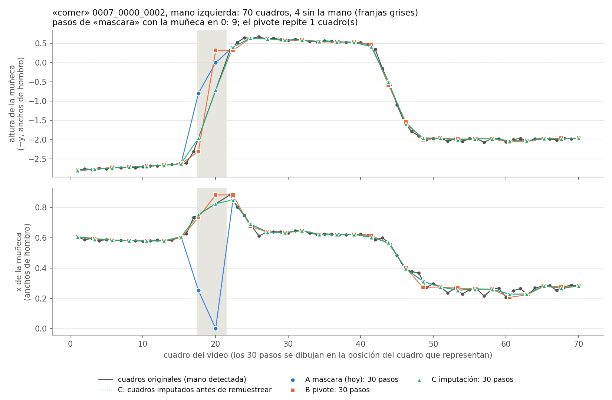
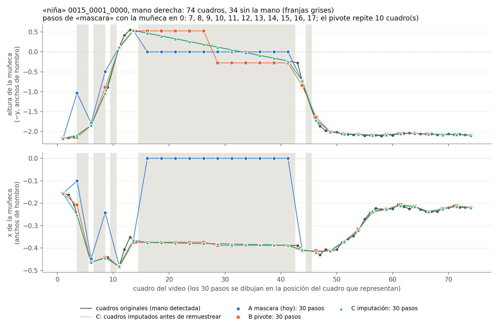
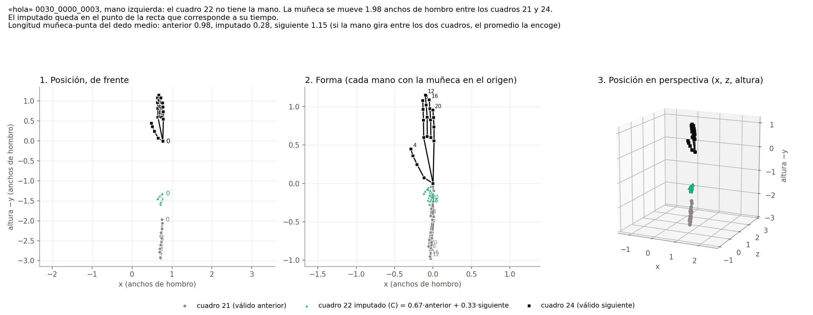
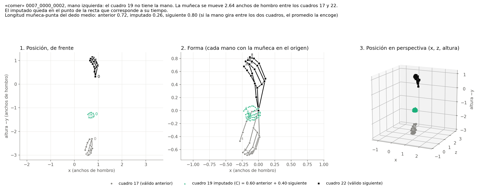
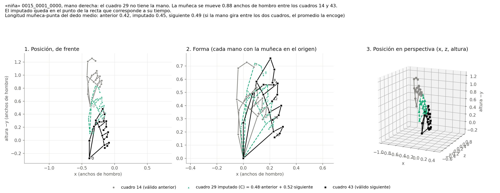
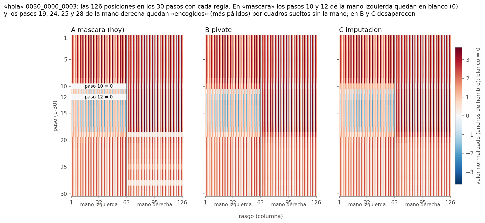

# Experimento: ¿qué hacer con los cuadros en los que no se detectó una mano?

Fecha: 2-oct-2026. Pedido del director en la reunión del 2-oct (N-60, encargo 1). Script:
`src/experimento_mano_ausente.py`; reglas: `src/mano_ausente_variantes.py`; pruebas:
`tests/test_mano_ausente_variantes.py`; figuras: `src/figuras_mano_ausente.py`. Salidas:
`models/experimento_mano_ausente_2026-10-02/`. Datos crudos: `docs/EXPERIMENTO_MANO_AUSENTE.json`.

Este experimento **no cambia el modelo canónico** ni `translator.py`.

## 1. Pregunta

Con la regla «mascara» (D-07), el bloque de 63 valores de una mano no detectada se pone en 0 después de
normalizar. Al remuestrear linealmente a 30 pasos, ese cero contamina los pasos vecinos: en «hola»
`0030_0000_0003` (69 cuadros) faltan la mano izquierda en los cuadros 22, 23, 26 y 27 (numerados desde 1;
21, 22, 25 y 26 en el código) y los pasos 10 y 12 quedan con la muñeca izquierda en 0. En el corpus, la
mano izquierda tiene algún paso contaminado en 636 de 1000 videos (2658 pasos: 1150 en cero exacto y 1508
«encogidos» hacia el origen) y la derecha en 413 (1291 pasos). Se comparan tres reglas.

## 2. Criterio prerregistrado

Escrito el **2-oct-2026 a las 18:04**, antes de lanzar las corridas completas y sin haber entrenado nada
con B ni con C (todavía no se ha corrido ni la prueba de humo).

**Brazos**, con todo lo demás canónico (30 pasos, aumentación ×10, paciencia 25, máx. 200 épocas, lote 64,
dropout 0,3, `add_velocity` después de la aumentación, red `build_model`):
A «mascara» (control), B «pivote», C «imputación» (definiciones exactas en §3). Semillas de entrenamiento
2026, 2027 y 2028; los 5 pliegues LOSO; 45 corridas.

**Métrica de decisión.** Exactitud top-1 de **validación** del checkpoint (`mejor_val_accuracy`, la misma
que decidió D-07 y D-08). Para cada brazo V y pliegue *k*, val(V, *k*) = media sobre las 3 semillas;
Δ*k*(V) = val(V, *k*) − val(A, *k*).

**Margen.** σ_semilla: para cada brazo, desviación estándar muestral (ddof = 1) entre las 3 semillas de la
validación media de 5 pliegues; se agrupa sobre los tres brazos como raíz de la media de las varianzas
(la definición de `BUSQUEDA_HIPERPARAMETROS.md`). **Margen = max(σ_semilla, 0,01).** Se reporta además,
como referencia, la desviación de una sola corrida (celda brazo × pliegue).

**Regla.**
- Una variante V ∈ {B, C} **reemplaza a «mascara»** solo si (a) media de Δ*k* > 0, (b) Δ*k* > 0 en **al
  menos 4 de 5** pliegues (Δ*k* = 0 no cuenta como mejora) y (c) media de Δ*k* > margen.
- Si ninguna cumple: «**no hay evidencia**» y se mantiene «mascara».
- Si cumple solo una, se elige esa.
- Si cumplen B y C y su diferencia de validación media es menor que el margen, se prefiere **C**
  (conserva la duración, no repite cuadros y es más simple de aplicar en vivo); si la diferencia es igual o
  mayor que el margen, la de mayor validación.
- Se reporta también si una variante **empeora** con la regla simétrica (Δ*k* < 0 en ≥ 4 de 5 y −media > margen).

**Lo que no decide.** La prueba LOSO (top-1, top-3, F1 macro sobre el señante no visto) se reporta como
descripción, con diferencias pareadas por pliegue, prueba de signos (binomial exacta, bilateral) y Wilcoxon
de rangos con signo (exacta, bilateral) sobre las 5 diferencias. Con 5 pliegues el p bilateral mínimo es
2/2⁵ = 0,0625: ninguna prueba puede dar p < 0,05.

**Control.** A con la semilla 2026 debe reproducir la referencia N-30 (top-1 por pliegue 0,460 / 0,533 /
0,606 / 0,615 / 0,685). Si no la reproduce, se investiga antes de comparar.

**Plan de ejecución.** Prueba de humo (1 pliegue, 2 épocas, aumentación ×2) en una carpeta temporal; luego las 45
corridas. Si no terminaran, el criterio se aplicaría con las semillas que tengan los 5 pliegues en los tres
brazos (mínimo 2), y se declararía.

**Registro de un ajuste antes de ver resultados (2-oct, 18:06).** Las corridas se lanzaron a las 18:04:54. Al
generar la figura de «niña» `0015_0001_0000` (hueco de 28 cuadros en la mano derecha) se vio que la primera
versión del pivote saltaba al otro lado del hueco: el primer momento sin mano tomaba el cuadro 43 (27 cuadros
más allá) porque era el único libre, y los diez momentos siguientes lo repetían. Se detuvieron las tres
corridas a las 18:06, cuando ninguna había terminado un solo pliegue (todas seguían en A, semilla y pliegue 0;
no existía ninguna métrica de B ni de C). Se añadió el tope de «cercano» de la regla B (§3, paso 3), se
añadió la prueba `test_hueco_largo_no_salta_al_otro_lado`, se borraron las carpetas incompletas y se
relanzaron las 45 corridas a las 18:07. Los registros de la tanda detenida quedan como
`abortada_1806_semilla_*.log`. El criterio de §2 no cambió.

## 3. Definición exacta de las reglas

Punto de partida, igual para los tres brazos: la secuencia de cada video tal como está en
`data/processed_holistic_mascara_rostro` en la representación «manos»: T cuadros × 126 (mano izquierda 0-62,
derecha 63-125), normalizada por hombros y con el bloque de la mano no detectada en 0 (D-07). Un bloque de 63
ceros exactos = mano no detectada en ese cuadro. Una mano detectada nunca normaliza a 63 ceros exactos.
Código: `src/mano_ausente_variantes.py`.

**A «mascara» (control).** `resample_sequence` (de `train_final_100.py`) sobre esa secuencia, sin cambios.
Para el momento j, p_j = j·(T−1)/29, y el valor es la interpolación lineal entre los cuadros ⌊p_j⌋ y
⌊p_j⌋+1. Si uno de los dos no tiene la mano, el paso queda en 0 (si el peso del cuadro sin mano es 1) o
«encogido» hacia el origen.

**B «pivote».** Ningún paso se interpola: cada momento toma un cuadro real en el que la mano sí se detectó. Se
decide por mano, así que las dos manos de un mismo momento pueden salir de cuadros distintos.
1. Cuadro nominal del momento j: c_j = ⌊p_j + 0,5⌋. Con T ≥ 30, que se cumple en todo el corpus (mínimo 40
   cuadros), los 30 cuadros nominales son distintos.
2. Si la mano se detectó en c_j, se usa c_j. Estos cuadros quedan reservados para su momento.
3. Si no, se recorren los momentos en orden y se busca, en la ventana abierta entre el cuadro elegido para el
   momento anterior y el cuadro nominal detectado del siguiente momento, el cuadro detectado y no usado más
   cercano a p_j (±1, ±2…; a igual distancia, primero hacia adelante). La ventana impide retroceder en el
   tiempo y respeta los cuadros reservados. **Tope de «cercano»:** el candidato no puede estar más de un
   espaciado entre momentos ((T−1)/29 cuadros, unos 2,3) más lejos de p_j que el cuadro que se repetiría
   en el paso 4.
4. Si no hay candidato, se repite el más cercano a p_j de los dos extremos de la ventana (el cuadro del
   momento anterior o el del siguiente detectado; empate: adelante). En un hueco largo esto equivale a
   «vecino más cercano»: la primera mitad del hueco repite el último cuadro anterior y la segunda, el primero
   posterior.
5. Mano no detectada en ningún cuadro del video: bloque en 0. En este corpus no ocurre nunca: las dos manos
   se detectan en al menos un cuadro de cada uno de los 1000 videos.

Ajustes respecto de la propuesta del encargo: la distancia se mide a p_j y no a c_j, lo que solo cambia los
empates; se añadieron la ventana monótona y el tope de cercanía. Una consecuencia inevitable de la
definición es que B cambia también los momentos sin hueco: pasa de interpolar entre dos cuadros a tomar el
cuadro más cercano. B difiere de A en dos cosas a la vez (§7).

**C «imputación».** Sobre los T cuadros, antes de remuestrear y por mano, cada cuadro sin la mano se rellena
coordenada a coordenada por interpolación lineal entre el último cuadro válido anterior (a) y el primero
válido siguiente (b): x_t = x_a + (t − a)/(b − a)·(x_b − x_a). En un hueco de un solo cuadro esto es el
promedio de los dos vecinos. Un hueco al inicio copia el primer valor válido y uno al final copia el último
(`np.interp`). Una mano nunca detectada queda en 0. Después se aplica `resample_sequence` a 30 pasos, como
hoy. La interpolación se hace en el espacio normalizado por hombros, es decir, sobre la posición de la mano
respecto del cuerpo. Ese es el espacio que existe en el processed y el que tendría el prototipo justo después
de `normalize_sequence`.

**Comprobaciones** (`experimento_mano_ausente.py verificar`, guardadas en `verificacion.json`, y
`tests/test_mano_ausente_variantes.py`, 19 pruebas):
- A es **bit a bit** `train_loso.remuestrear_todas` sobre las 1000 muestras. En «hola», los cuadros sin mano
  izquierda son 21, 22, 25 y 26 (base 0) y los pasos en 0 son el 9 y el 11 (base 0), es decir, los pasos 10
  y 12 que señaló el director.
- Las tres reglas **conmutan con el espejo** de la aumentación: espejar(regla(X)) = regla(espejar(X)), con
  diferencia máxima de 0 en 1 de cada 7 muestras. Las reglas se aplican al construir X_seq, antes de la
  aumentación. Las velocidades se calculan después de aumentar, como hoy, con `add_velocity` dentro de
  `entrenar_y_evaluar`.
- Pruebas unitarias: hueco interior de 1 cuadro (promedio exacto) y de varios (recta exacta), hueco al
  inicio y al final (copia), mano nunca vista (ceros), pivote sin huecos (cuadros nominales), alternancia
  adelante/atrás, hueco largo sin salto al otro lado, orden temporal y valores tomados de cuadros reales. La
  suite completa del repositorio pasa: 572 pruebas, 19 de ellas nuevas.

Efecto sobre los datos (1000 secuencias × 30 pasos):

| | mano izq.: pasos en 0 | mano izq.: transiciones 0↔no 0 | mano der.: pasos en 0 | velocidad de la mano, p99 (izq. / der.) |
|---|---|---|---|---|
| A mascara | 1150 (353 videos) | 1095 | 347 (164 videos) | 8,06 / 7,98 |
| B pivote | 0 | 0 | 0 | 6,97 / 5,62 |
| C imputación | 0 | 0 | 0 | 6,17 / 5,20 |

Con A, además de los pasos en 0, hay 1508 pasos de la mano izquierda y 944 de la derecha «encogidos»: el
remuestreo los mezcla con un cuadro en ceros. Pivote: 2747 momentos-mano usan un cuadro distinto del nominal
(mediana 1,1 cuadros de distancia al momento; p95 7,3; máximo 28, en huecos al inicio del video) y 935
momentos-mano repiten un cuadro ya usado. Diferencia media absoluta con A: B 0,041 y C 0,030 (en anchos de
hombro).

## 4. Figuras

Generadas con `src/figuras_mano_ausente.py` **antes de que existiera cualquier resultado** (primera versión
a las 18:06; regeneradas a las 18:10 con el pivote corregido, con las corridas ya en marcha pero antes de que
terminara el primer pliegue, a las 18:11). No muestran personas, solo números,
trayectorias y esqueletos de la mano. Están en `docs/figuras_2026-10-02/` y copiadas a
`Tesis/Presentaciones_privadas/explicaciones/`. Cuadros y pasos se numeran desde 1, como en la reunión. Los
datos de las figuras están en `docs/figuras_2026-10-02/mano_ausente_figuras.json`.

Videos elegidos (los tres con huecos, uno de ellos largo):

| video | mano | cuadros | cuadros sin la mano | pasos de A en 0 |
|---|---|---|---|---|
| «hola» 0030_0000_0003 | izquierda | 69 | 22, 23, 26, 27 (dos huecos de 2) | 10, 12 |
| «comer» 0007_0000_0002 | izquierda | 70 | 18-21 (hueco de 4, con mucho movimiento) | 9 |
| «niña» 0015_0001_0000 | derecha | 74 | 4, 5, 7, 8, 10, **15-42 (hueco de 28)**, 45 | 7 a 17 (11 pasos) |

**a) Trayectoria de la muñeca** (`mano_ausente_a_trayectoria_*.png`): altura (−y) y x de la muñeca de la mano
afectada. Las franjas grises son los cuadros sin la mano. Cada paso se dibuja en la posición p_j que
representa.
- 
- 
- 

Lectura. Con A, la muñeca «cae» a 0 en los pasos 10 y 12 de «hola». En x, que debería valer unos 0,7 anchos
de hombro, el salto es de 0,7, y en altura de hasta 1,2. En «niña», los 11 pasos del hueco quedan en el origen.
B y C siguen la trayectoria real. Con huecos cortos son casi idénticos. En el hueco largo de «niña», C traza
una recta entre el último cuadro antes del hueco y el primero después, y B se queda quieto en el cuadro 14
durante 6 pasos seguidos (el suyo y 5 más) y luego en el 43 durante otros 6 (10 repeticiones en total): dos mesetas con un escalón. Ninguno de los dos
sabe qué hizo la mano durante esos 28 cuadros (casi un segundo). Simplemente lo rellenan de forma diferente.

**b) Mano 3D en un cuadro faltante** (`mano_ausente_b_mano3d_*.png`): el cuadro válido anterior, el imputado
por C y el válido siguiente, superpuestos. El panel 1 muestra la posición de frente, el 2 la forma (cada mano
con la muñeca en el origen) y el 3 la posición en perspectiva.
- 
- 
- 

Lectura. El imputado queda en la posición intermedia que le corresponde por tiempo. En «hola», el cuadro 22 =
0,67 × cuadro 21 + 0,33 × cuadro 24, y la muñeca sube 1,98 anchos de hombro entre ambos. Esto confirma lo que
pidió ver el director. Pero aparece un efecto que no se esperaba: **cuando la mano gira entre los dos cuadros
válidos, el promedio la encoge.** En «hola» la mano pasa de colgar (dedos abajo) a levantarse (dedos arriba);
la distancia muñeca-punta del dedo medio es de 0,98 en el cuadro anterior y de 1,15 en el siguiente, pero de
solo **0,28** en el imputado. En «comer» ocurre lo mismo: 0,72 → 0,26 → 0,80. En «niña», donde la mano casi no
gira, la forma se conserva (0,42 → 0,45 → 0,49). La interpolación lineal punto a punto es correcta para la
posición, pero no para la orientación: una mano que rota no pasa por una mano encogida. Aun así es mucho más
parecida a la real que un bloque de ceros.

**c) Mapas 30 × 126** de «hola» (`mano_ausente_c_mapas_hola_0030_0000_0003.png`):

Con A, los pasos 10 y 12 de la mano izquierda son franjas blancas (0). Los pasos 19, 24, 25 y 28 de la mano
derecha aparecen más pálidos («encogidos»): un solo cuadro suelto sin la mano derecha (43, 54, 56, 58 y 64)
basta para contaminar el paso vecino. En B y C estas franjas desaparecen.

## 5. Ejecución

45 corridas (3 brazos × 3 semillas × 5 pliegues), de 18:07 a 19:19 del 2-oct-2026. Se corrieron tres procesos
en paralelo, uno por semilla, y cada uno recorrió los pliegues y, dentro de cada pliegue, los brazos A → B → C.
Duración: unos 4,5 min por corrida bajo carga (A 255 s, B 275 s y C 281 s de media; carga del equipo ≈ 44). El paralelismo no altera los números: **A con la
semilla 2026 reproduce N-30 bit a bit**, con top-1 por pliegue 0,460 / 0,533 / 0,606 / 0,615 / 0,685, las
mismas validaciones (0,95 / 0,90 / 0,91 / 0,96 / 0,94) y las mismas épocas (67 / 46 / 42 / 61 / 62). Las
semillas 2027 y 2028 de A también coinciden exactamente con el brazo A del experimento de velocidades del
30-sep.

Costo de construir los 30 pasos de una ventana (`inferencia`, 200 videos, mediana): A 0,16 ms, B 0,05 ms y
C 0,28 ms. La red es la misma en los tres brazos (30 × 252, 714 291 parámetros), así que su latencia no
cambia: unos 12 ms a lote 1 (EXPERIMENTO_VELOCIDADES §4.1). Imputar añade 0,12 ms, el 1 % de esa latencia.

## 6. Resultados

### 6.1 Por brazo

Media sobre los 5 pliegues de la media de las 3 semillas por pliegue; ± es la desviación estándar entre
pliegues.

| brazo | **val top-1** | val top-3 | val F1 | LOSO top-1 | LOSO top-3 | LOSO F1 macro | épocas ejecutadas | mejor época |
|---|---|---|---|---|---|---|---|---|
| A mascara (canónica) | **0,920** ± 0,020 | 0,973 | 0,911 | 0,589 ± 0,094 | 0,764 | 0,544 | 54,5 | 29,5 |
| B pivote | **0,933** ± 0,026 | 0,977 | 0,926 | 0,615 ± 0,129 | 0,778 | 0,569 | 58,9 | 33,9 |
| C imputación | **0,939** ± 0,026 | 0,979 | 0,934 | 0,619 ± 0,123 | 0,774 | 0,576 | 61,5 | 36,5 |

Por semilla (media de 5 pliegues; validación / LOSO top-1 / F1):

| semilla | A | B | C |
|---|---|---|---|
| 2026 | 0,932 / 0,580 / 0,537 | 0,934 / 0,615 / 0,571 | 0,942 / 0,607 / 0,561 |
| 2027 | 0,918 / 0,592 / 0,539 | 0,934 / 0,623 / 0,574 | 0,942 / 0,616 / 0,575 |
| 2028 | 0,910 / 0,596 / 0,554 | 0,932 / 0,606 / 0,561 | 0,934 / 0,635 / 0,591 |

### 6.2 Por pliegue (media de las 3 semillas)

| pliegue (señante) | val A | val B | val C | top-1 A | top-1 B | top-1 C | top-3 A | top-3 B | top-3 C | F1 A | F1 B | F1 C | épocas A / B / C |
|---|---|---|---|---|---|---|---|---|---|---|---|---|---|
| 0 (0000) | 0,923 | 0,933 | 0,957 | 0,452 | 0,412 | 0,418 | 0,627 | 0,557 | 0,560 | 0,400 | 0,366 | 0,377 | 56 / 48 / 60 |
| 1 (0001) | 0,893 | 0,910 | 0,917 | 0,536 | 0,571 | 0,585 | 0,715 | 0,762 | 0,757 | 0,472 | 0,522 | 0,536 | 46 / 64 / 83 |
| 2 (0002) | 0,917 | 0,923 | 0,927 | 0,631 | 0,652 | 0,678 | 0,786 | 0,818 | 0,827 | 0,604 | 0,604 | 0,635 | 54 / 54 / 48 |
| 3 (0003) | 0,950 | 0,977 | 0,977 | 0,640 | 0,727 | 0,700 | 0,827 | 0,867 | 0,840 | 0,603 | 0,683 | 0,665 | 58 / 68 / 56 |
| 4 (0004) | 0,917 | 0,923 | 0,920 | 0,687 | 0,712 | 0,715 | 0,863 | 0,887 | 0,888 | 0,639 | 0,667 | 0,667 | 58 / 60 / 61 |

Valores por semilla (validación; top-1 de prueba), semillas 2026 / 2027 / 2028:

| pliegue | A val | B val | C val | A top-1 | B top-1 | C top-1 |
|---|---|---|---|---|---|---|
| 0 | 0,95 / 0,92 / 0,90 | 0,94 / 0,93 / 0,93 | 0,96 / 0,96 / 0,95 | 0,460 / 0,480 / 0,415 | 0,400 / 0,400 / 0,435 | 0,390 / 0,400 / 0,465 |
| 1 | 0,90 / 0,90 / 0,88 | 0,91 / 0,92 / 0,90 | 0,91 / 0,92 / 0,92 | 0,533 / 0,492 / 0,583 | 0,558 / 0,628 / 0,528 | 0,583 / 0,603 / 0,568 |
| 2 | 0,91 / 0,91 / 0,93 | 0,93 / 0,92 / 0,92 | 0,92 / 0,94 / 0,92 | 0,606 / 0,606 / 0,682 | 0,672 / 0,652 / 0,631 | 0,692 / 0,672 / 0,672 |
| 3 | 0,96 / 0,96 / 0,93 | 0,96 / 0,99 / 0,98 | 0,98 / 0,99 / 0,96 | 0,615 / 0,650 / 0,655 | 0,740 / 0,735 / 0,705 | 0,670 / 0,690 / 0,740 |
| 4 | 0,94 / 0,90 / 0,91 | 0,93 / 0,91 / 0,93 | 0,94 / 0,90 / 0,92 | 0,685 / 0,730 / 0,645 | 0,705 / 0,700 / 0,730 | 0,700 / 0,715 / 0,730 |

### 6.3 Comparación pareada

Diferencia por pliegue de las medias sobre semillas. Signos: binomial exacta bilateral, sin empates.
Wilcoxon: rangos con signo, exacta, bilateral. «Pares» = pares (pliegue, semilla) a favor / en contra / total;
es solo descriptivo, porque las semillas de un mismo pliegue no son independientes.

| comparación | métrica | Δ por pliegue 0 / 1 / 2 / 3 / 4 | Δ media | pliegues a favor | signos p | Wilcoxon p | pares |
|---|---|---|---|---|---|---|---|
| B − A | **val top-1** | +0,010 / +0,017 / +0,007 / +0,027 / +0,007 | **+0,013** | **5 / 5** | 0,0625 | 0,0625 | 11 / 3 / 15 |
| B − A | LOSO top-1 | −0,040 / +0,035 / +0,020 / +0,087 / +0,025 | +0,025 | 4 / 5 | 0,375 | 0,44 | 10 / 5 / 15 |
| B − A | LOSO top-3 | −0,070 / +0,047 / +0,032 / +0,040 / +0,023 | +0,014 | 4 / 5 | 0,375 | 0,63 | 9 / 5 / 15 |
| B − A | F1 macro | −0,033 / +0,050 / −0,000 / +0,080 / +0,028 | +0,025 | 3 / 5 | 1,00 | 0,44 | 10 / 5 / 15 |
| C − A | **val top-1** | +0,033 / +0,023 / +0,010 / +0,027 / +0,003 | **+0,019** | **5 / 5** | 0,0625 | 0,0625 | 12 / 1 / 15 |
| C − A | LOSO top-1 | −0,033 / +0,049 / +0,047 / +0,060 / +0,028 | +0,030 | 4 / 5 | 0,375 | 0,19 | 10 / 5 / 15 |
| C − A | LOSO top-3 | −0,067 / +0,042 / +0,040 / +0,013 / +0,025 | +0,011 | 4 / 5 | 0,375 | 0,63 | 10 / 4 / 15 |
| C − A | F1 macro | −0,023 / +0,064 / +0,031 / +0,062 / +0,028 | +0,032 | 4 / 5 | 0,375 | 0,13 | 10 / 5 / 15 |
| C − B | val top-1 | +0,023 / +0,007 / +0,003 / 0,000 / −0,003 | +0,006 | 3 / 5 | 0,63 | 0,44 | 7 / 4 / 15 |
| C − B | LOSO top-1 | +0,007 / +0,013 / +0,027 / −0,027 / +0,003 | +0,005 | 4 / 5 | 0,375 | 0,44 | 8 / 5 / 15 |
| C − B | F1 macro | +0,011 / +0,014 / +0,031 / −0,019 / −0,000 | +0,007 | 3 / 5 | 1,00 | 0,63 | 9 / 6 / 15 |

**Variación entre semillas.** σ_semilla agrupada (definición de §2) = **0,0070**. Como es menor que el piso,
**margen = 0,010**. Como referencia, la desviación de una sola corrida (celda brazo × pliegue) es 0,0141.

## 7. Veredicto según el criterio prerregistrado

| variante | (a) Δ media > 0 | (b) Δ*k* > 0 en ≥ 4 de 5 | (c) Δ media > margen (0,010) | cumple |
|---|---|---|---|---|
| B pivote | +0,0133 ✔ | 5 de 5 ✔ | 0,0133 > 0,010 ✔ | **sí** |
| C imputación | +0,0193 ✔ | 5 de 5 ✔ | 0,0193 > 0,010 ✔ | **sí** |

Cumplen las dos. Su diferencia de validación media es C − B = **0,006**, menor que el margen de 0,010. Por la
regla de empate prerregistrada, **se prefiere C**.

**Veredicto: según el criterio prerregistrado, la imputación (C) debe reemplazar a «mascara» como
tratamiento de la mano no detectada.** El veredicto es una **recomendación**: este experimento no cambia el
modelo canónico, el umbral ni `translator.py`. Adoptarla es una decisión que corresponde tomar con el
director (§9).

Lo que dice la descripción, sin valor de decisión:
- **Prueba LOSO.** C sube el top-1 de 0,589 a 0,619 (+3,0 puntos) y el F1 macro de 0,544 a 0,576 (+3,2), y
  mejora en 4 de 5 pliegues. Gana además en las tres semillas por separado (0,607 / 0,616 / 0,635 frente a
  0,580 / 0,592 / 0,596). B da +2,5 puntos de top-1 y +2,5 de F1. Ninguna prueba llega a p < 0,05, ni puede
  llegar (§8).
- **El señante 0000 (pliegue 0) empeora en prueba con las dos variantes:** top-1 0,452 → 0,412 (B) y 0,418
  (C), y top-3 0,627 → 0,557 y 0,560. Sin embargo, es el pliegue donde la validación más sube (C +3,3 puntos).
  Es el mismo patrón de N-58 (c07): la mejora no alcanza al señante atípico. Los ceros de «mascara» podrían
  estar funcionando como una señal útil para ese señante (por ejemplo, si su mano izquierda se pierde en
  posiciones características). Con un solo señante no se puede distinguir de la variación entre semillas, que
  en ese pliegue es de hasta 7,5 puntos en la prueba.
- **B frente a C.** Son indistinguibles: 0,6 puntos en validación (3 de 5 pliegues a favor de C) y 0,5 en
  prueba. Esto encaja con las figuras: en los huecos cortos, que son la mayoría (1810 de los 2821 huecos
  interiores son de un solo cuadro), las dos reglas dan casi lo mismo.
- **Épocas.** B y C entrenan algo más (58,9 y 61,5 épocas frente a 54,5) y alcanzan su mejor época más tarde
  (33,9 y 36,5 frente a 29,5): con datos más limpios, la validación sigue subiendo durante más tiempo.

## 8. Pruebas estadísticas y sus límites con 5 pliegues

- Con n = 5 diferencias, el p bilateral más pequeño posible es 2/2⁵ = **0,0625**, tanto en la prueba de
  signos como en Wilcoxon exacta, y solo se alcanza si los 5 pliegues van en el mismo sentido. B − A y
  C − A en validación llegan exactamente a ese mínimo: es el máximo de evidencia que este diseño puede dar.
  Por eso el criterio no usa un p-valor, sino la regla de 4 de 5 más el tamaño frente al margen.
- En la prueba LOSO, 4 de 5 pliegues da p = 0,375 (signos). Wilcoxon da 0,19 para C − A en top-1 y 0,13 en F1.
- Los pliegues no son réplicas independientes: comparten 3 de los 4 señantes de entrenamiento.
- La resolución de la validación es de 0,01 por corrida (100 muestras). El Δ de B (0,0133) equivale, en
  media, a 1,3 muestras de validación por pliegue.

## 9. Cautelas

1. **El margen de B depende del piso.** σ_semilla = 0,007, así que el margen lo fija el piso de 0,01. Con la
   desviación de una sola corrida (0,014), que es el umbral más exigente usado en EXPERIMENTO_VELOCIDADES, B
   **no** cumpliría (0,0133 < 0,0141) y C sí (0,0193). La elección de C no depende de esto; que B también
   cumpla, sí.
2. **La mejora no llega al señante 0000** (§7). Si el objetivo prioritario fuera el peor caso entre señantes,
   este resultado no lo respalda.
3. **La validación sale de los señantes ya vistos** (D-06). Aquí la validación y la prueba van en el mismo
   sentido en 4 de 5 pliegues, pero no en el pliegue 0.
4. **La imputación inventa movimiento en huecos largos.** En «niña» traza una recta durante 28 cuadros. En el
   corpus, 55 huecos interiores (de 2821) duran 10 cuadros o más. Además, encoge la mano cuando esta gira entre los dos
   cuadros válidos (figura b). Una alternativa más fiel interpolaría por separado la posición de la muñeca y la
   forma relativa a ella; queda como trabajo futuro y exigiría su propio criterio.
5. **B cambia dos cosas a la vez** (§3): además de tratar los huecos, sustituye la interpolación por el cuadro
   más cercano en todos los pasos. No se puede separar cuánto aporta cada una. Como C gana sin ese cambio,
   tampoco hace falta para la decisión.
6. **Interacción con N-58 no probada.** La recomendación de c07 (arquitectura) y la de 60 pasos se midieron
   con «mascara». Con 60 pasos, el remuestreo se acerca a la tasa original y la contaminación de «mascara»
   cambia. Si se adopta más de un cambio, hay que medir la combinación.
7. **Tres semillas y cinco señantes.** Un efecto real de 1 a 2 puntos queda en el límite de lo que el diseño
   puede resolver.
8. **Detalle de la definición de B.** El tope de cercanía se añadió tras ver una figura, a las 18:06 y antes
   de cualquier resultado (§2). Sin el tope, B habría sido peor en los huecos largos.
9. Las cifras de huecos y pasos contaminados usan las 1000 muestras del processed, incluidos los 3 duplicados
   que D-06 excluye. La diferencia es despreciable.

## 10. Cómo se aplicaría C en el prototipo en vivo (sin cambiarlo)

Hoy, `translator.py` (`SignTranslator._preprocesar`) procesa la ventana de N cuadros así: pila → fotograma sin
pose a 0 → detección de manos ausentes (`sin_izq`, `sin_der`) → `normalize_sequence` → **mascara** (pone en 0
el bloque ausente) → columnas de la representación → `resample_sequence(seq, 30)` → `add_velocity`. Para
aplicar C habría que:

1. **`translator.py`.** Añadir `"imputacion"` a `MANO_AUSENTE_OPCIONES`. En `_preprocesar`, con
   `mano_ausente == "imputacion"`, aplicar primero la máscara (como ahora, para que el 0 marque «sin dato»).
   Después, ya con las columnas de la representación y **antes** de `resample_sequence`, sustituir los bloques
   ausentes por la interpolación entre el cuadro válido anterior y el siguiente de **la misma ventana**: el
   equivalente de `mano_ausente_variantes.imputar_fotogramas`, usando las máscaras `sin_izq` y `sin_der` ya
   calculadas, en lugar de volver a detectar ceros. Las posiciones de los bloques de mano dependen de la
   representación (en «manos», 0:63 y 63:126; en «manos_postura», 99:162 y 162:225), así que la función
   tiene que recibir esos índices.
2. **Ventana en vivo.** Es la diferencia práctica con el corpus: en vivo los huecos al borde de la ventana son
   más frecuentes (la mano entra o sale del encuadre). C copia ahí el valor válido más cercano, en lugar del
   0 de hoy. La regla de `max_sin_manos` (no inferir si faltan manos en más de la proporción máxima) se
   mantiene igual y se aplica antes. Una mano que no aparece en ningún cuadro de la ventana sigue en 0. La
   imputación solo usa cuadros de la ventana cerrada, así que no añade espera; cuesta unos 0,3 ms por ventana.
3. **Procedencia y coherencia corpus-prototipo (D-05).** El modelo reentrenado tendría que declarar
   `"mano_ausente": "imputacion"` en su `.procedencia.json`, y `translator.py` debería seguir negándose a una
   regla distinta de la del corpus. Para el entrenamiento hay dos opciones: (a) una opción
   `--mano-ausente imputacion` en `preprocess_lsc50.py`, que imputa tras normalizar y escribe un processed
   nuevo, y deja `train_loso.py` y `train_final_100.py` sin tocar; o (b) aplicar la regla al construir X_seq,
   como hace este experimento. La (a) es más simple y deja la regla en un solo sitio.
4. **`realtime.py`.** Añadir `imputacion` a las opciones de `--mano-ausente`.
5. **Pruebas.** Añadir a `tests/test_prototipo.py` que la ventana con huecos produce la misma entrada que el
   corpus imputado, igual que hoy se prueba «mascara».
6. **Lo que arrastra adoptarla.** Reentrenar el modelo canónico, rehacer el LOSO de referencia (las cifras
   citadas 0,580 y 0,920 cambiarían), recalibrar los umbrales (D-09, N-47) y registrar la decisión como
   revisión de D-07 en `DECISIONES_TESIS.txt`.

## 11. Explicación simple

MediaPipe a veces no encuentra una mano en algunos cuadros del video. Hasta ahora, en esos cuadros la mano se
anotaba como «ceros», y al resumir el video en 30 momentos esos ceros se colaban: la red veía la mano saltar
al centro del pecho y volver. Probamos dos arreglos. El primero, «pivote», usa en cada momento el cuadro real
más cercano donde sí se vio la mano. El segundo, «imputación», rellena el hueco con el punto intermedio entre
el cuadro de antes y el de después. Entrenamos la red tres veces con cada forma y la probamos siempre con una
persona que no vio al aprender. Los dos arreglos aciertan más que los ceros: con la imputación, 62 % frente a
59 % con personas nuevas. Según la regla fijada antes de empezar, se recomienda la imputación. No mejora a
la persona más difícil del corpus, y en huecos muy largos se inventa un movimiento en línea recta.

## 12. Archivos

- `src/mano_ausente_variantes.py`: las tres reglas (`regla_mascara`, `regla_pivote`, `regla_imputacion`,
  `imputar_fotogramas`, `indices_pivote`, `remuestrear_todas_con_regla`).
- `tests/test_mano_ausente_variantes.py`: 19 pruebas (`python -m unittest tests.test_mano_ausente_variantes`).
- `src/experimento_mano_ausente.py`: subcomandos `verificar`, `entrenar`, `inferencia` y `resumen`.
- `src/figuras_mano_ausente.py`: figuras de §4.
- `models/experimento_mano_ausente_2026-10-02/`: modelos y métricas por brazo, semilla y pliegue
  (`A_mascara/`, `B_pivote/`, `C_imputacion/`), `verificacion.json`, `inferencia.json`,
  `resultados_mano_ausente.json`, registros `corrida_semilla_*.log` y los de la tanda detenida
  (`abortada_1806_semilla_*.log`). Cada `modelo.procedencia.json` declara su regla y advierte que no es el
  modelo canónico.
- `docs/EXPERIMENTO_MANO_AUSENTE.json`: datos crudos (las 45 corridas, agregados, comparaciones, criterio,
  reproducción de N-30, verificación e inferencia).
- `docs/figuras_2026-10-02/mano_ausente_*.png` y `mano_ausente_figuras.json`, copiados a
  `Tesis/Presentaciones_privadas/explicaciones/`.

Reproducir: `python src/experimento_mano_ausente.py verificar`, luego
`entrenar --semillas 2026,2027,2028`, `inferencia`, `resumen --docs` y `python src/figuras_mano_ausente.py`, con el
intérprete `python` (el `venv/` del repositorio es de Windows).
