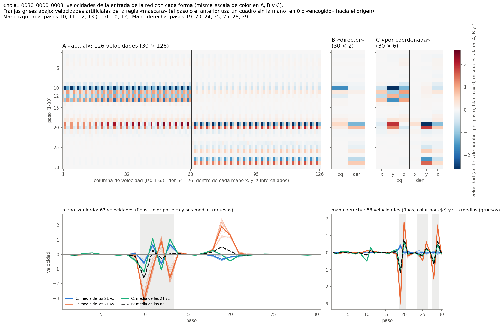

# Experimento: ¿se pueden reducir las velocidades a una columna por mano?

Fecha: 2-oct-2026. Pedido del director en la reunión del 2-oct (N-60, encargo 2). Script:
`src/experimento_velocidades_reducidas.py`; reducciones: `src/velocidades_reducidas.py`; pruebas:
`tests/test_velocidades_reducidas.py`. Salidas: `models/experimento_velocidades_reducidas_2026-10-02/`.
Datos crudos: `docs/EXPERIMENTO_VELOCIDADES_REDUCIDAS.json`.

Este experimento **no cambia el modelo canónico** ni `translator.py`.

## 1. Pregunta

La entrada canónica de la red es 30 × 252: 126 posiciones de las dos manos (D-08) y sus 126 velocidades
(`add_velocity`: vel[t] = x[t] − x[t−1], vel[1] = 0). Al ver el mapa de colores de «hola», el director
observó que las 63 columnas de velocidad de cada mano se comportan casi igual (los 21 puntos de una mano se
mueven juntos) y propuso promediarlas en una sola columna por mano. Así habría menos rasgos y menos cómputo.
El experimento previo (`EXPERIMENTO_VELOCIDADES.md`, N-58 b) ya mostró que las 126 velocidades no aportan una
mejora medible. Promediar las 63 columnas mezcla x, y y z: un movimiento hacia la derecha y otro hacia arriba
del mismo tamaño se cancelan. Por eso se prueba también una variante que promedia cada coordenada por separado.

| brazo | entrada | velocidades que recibe la red |
|---|---|---|
| A «actual» (control) | 30 × 252 | las 126 de `add_velocity` |
| B «director» | 30 × 128 | 2: por cada mano, la media de sus 63 columnas de velocidad en cada paso |
| C «por coordenada» | 30 × 132 | 6: por cada mano, la media de las 21 vx, de las 21 vy y de las 21 vz |

## 2. Criterio prerregistrado

Escrito el **2-oct-2026 a las 19:28**, antes de lanzar las corridas completas. Hasta este momento solo se
han corrido las pruebas unitarias, el subcomando `verificar` (sin entrenar) y una prueba de humo de 2 épocas
con aumentación ×2 en una carpeta temporal, que no informa nada sobre la exactitud.

**Brazos.** A, B y C de §1. Todo lo demás es canónico: regla «mascara» (D-07, la vigente), representación
«manos», 30 pasos, aumentación ×10, paciencia 25, máx. 200 épocas, lote 64, dropout 0,3 y red `build_model`.
Las velocidades reducidas se calculan como `add_velocity`, **después** del remuestreo y de la aumentación, a
partir de las velocidades completas. Semillas de entrenamiento 2026, 2027 y 2028; los 5 pliegues LOSO;
45 corridas.

**Métrica de decisión.** Exactitud top-1 de **validación** del checkpoint (`mejor_val_accuracy`, la misma
que decidió D-07 y D-08). Para cada brazo V y pliegue *k*, val(V, *k*) es la media sobre las 3 semillas, y
Δ*k*(V) = val(V, *k*) − val(A, *k*).

**Margen.** σ_semilla: para cada brazo, desviación estándar muestral (ddof = 1) entre las 3 semillas de la
validación media de 5 pliegues. Se agrupa sobre los tres brazos como raíz de la media de las varianzas (la
definición de `BUSQUEDA_HIPERPARAMETROS.md` y `EXPERIMENTO_MANO_AUSENTE.md`). **Margen = max(σ_semilla, 0,01).**
Como referencia se reporta también la desviación de una sola corrida (celda brazo × pliegue).

**Regla específica de este experimento (no inferioridad).** El objetivo del director es **reducir** rasgos
sin perder exactitud. Por eso una variante más pequeña no tiene que ganar, sino **no ser peor** que A:
- V ∈ {B, C} **no es peor que A** si (a) la media de Δ*k* ≥ −margen **y** (b) Δ*k* < −margen en **a lo sumo
  1** de los 5 pliegues. Es decir, no pierde por más del margen en más de un pliegue.
- Si solo una cumple, se **adopta** esa.
- Si cumplen B y C, gana la más pequeña (**B**), salvo que val(C) − val(B) > margen; en ese caso, C.
- Si ninguna cumple, se mantiene **A** (las 126 velocidades).
- Las comparaciones con el margen usan una tolerancia de 1e-9 para el redondeo de coma flotante. Las
  validaciones son múltiplos de 0,01 promediados sobre 3 semillas, y un Δ*k* de −0,0100 exacto no cuenta
  como «pierde por más del margen».
- Como información, sin valor de decisión, se reporta además si alguna variante cumpliría la regla general
  de **mejora** (Δ media > margen y Δ*k* > 0 en ≥ 4 de 5 pliegues).

**Lo que no decide.** La prueba LOSO (top-1, top-3 y F1 macro sobre el señante no visto) se reporta como
descripción, con las diferencias pareadas por pliegue, una prueba de signos (binomial exacta, bilateral) y una
de Wilcoxon de rangos con signo (exacta, bilateral) sobre las 5 diferencias. Con 5 pliegues el p bilateral
mínimo es 2/2⁵ = 0,0625, así que ninguna prueba puede dar p < 0,05. Tampoco deciden los parámetros ni la
latencia: se miden y se reportan.

**Control.** A con la semilla 2026 debe reproducir la referencia N-30: top-1 por pliegue 0,460 / 0,533 /
0,606 / 0,615 / 0,685 (media 0,580). Si no la reproduce, se investiga antes de comparar. Además, A debería
coincidir con el brazo A del experimento de velocidades del 30-sep en las tres semillas (mismo código
canónico, determinista).

**Plan de ejecución.** Tres procesos en paralelo, uno por semilla. Cada uno recorre los pliegues y, dentro
de cada pliegue, A → B → C. El paralelismo no altera los números: en `EXPERIMENTO_MANO_AUSENTE.md` se
reprodujo N-30 bit a bit así. La latencia se mide al final, sin entrenamientos activos. Si las corridas no
terminaran, el criterio se aplicaría con las semillas que tengan los 5 pliegues en los tres brazos (mínimo 2),
y se declararía.

## 3. Definición exacta y comprobaciones

Las 126 posiciones («manos») son: mano izquierda en las columnas 0-62 y derecha en las 63-125. Dentro de cada
mano van 21 puntos × (x, y, z) intercalados: la columna 3·p + c es la coordenada c del punto p. Con V = las 126
velocidades de `add_velocity`:

- **B «director»** (2 columnas, orden [izq, der]): B_mano[t] = (1/63) · Σ de las 63 columnas de V de esa mano en t.
- **C «por coordenada»** (6 columnas, orden [izq_vx, izq_vy, izq_vz, der_vx, der_vy, der_vz]):
  C_mano,c[t] = (1/21) · Σ_p V[t, 3·p + c] de esa mano.
- El paso 1 vale 0 en las tres formas, como en `add_velocity`. Las posiciones no cambian.

Dónde se calculan: `train_loso.entrenar_y_evaluar` aumenta las 126 posiciones (el espejo niega las x e
intercambia las manos) y **después** llama a `canon[2]`. El experimento sustituye `canon[2]` por la función del
brazo; en A es la propia `add_velocity`. Así, las velocidades reducidas siempre salen de las posiciones ya
espejadas.

Comprobaciones (`tests/test_velocidades_reducidas.py`, 14 pruebas que pasan; `verificar` → `verificacion.json`):
- A es **bit a bit** `add_velocity` sobre las 1000 secuencias; anchos 252 / 128 / 132; posiciones intactas.
- B y C coinciden columna por columna con las medias calculadas a mano.
- **Espejo y luego reducir.** En C, las manos se intercambian y vx cambia de signo, mientras vy y vz quedan
  iguales: error máximo 0 en el corpus. En B, la columna de una mano tras el espejo es
  (−Σvx + Σvy + Σvz)/63 de la otra mano (error máximo 2,8e-7). B **no** es una función de las 2 columnas sin
  espejar: limitarse a intercambiar las 2 columnas daría errores de hasta 1,0. Por eso hay que reducir después
  de aumentar, que es lo que se hace.
- La aumentación es determinista con la semilla, opera sobre 126 columnas y no depende del brazo.
- Ejemplos sintéticos: si los 21 puntos se trasladan (dx, dy, dz), C devuelve exactamente (dx, dy, dz) y B
  devuelve (dx + dy + dz)/3. Un movimiento con +x y −y del mismo tamaño da B = 0: el caso de la advertencia.

**¿Se mueven juntos los 63 números de una mano?** (corpus remuestreado, 1000 secuencias, pasos 2-30 con
movimiento; `verificacion.json`). Calculado antes de entrenar.

| | mano izquierda | mano derecha |
|---|---|---|
| correlación mediana entre las 63 columnas de velocidad | 0,42 | 0,42 |
| correlación mediana entre las 21 columnas de un mismo eje (x / y / z) | 0,89 / 0,97 / 0,996 | 0,87 / 0,98 / 0,996 |
| correlación entre las medias de los ejes (x-y / x-z / y-z) | 0,00 / 0,30 / 0,45 | −0,03 / −0,21 / 0,45 |
| energía de las 126 velocidades que conserva **B** (cada columna ← media de su mano) | 47 % | 42 % |
| energía que conserva **C** (cada columna ← media de su mano y eje) | 97 % | 97 % |
| lo mismo, solo en pasos con la mano presente en t y t−1 (B / C) | 42 % / 96 % | 42 % / 97 % |

«Energía» es la suma de cuadrados de las velocidades; la fracción conservada es 1 − (error al reemplazar cada
columna por la media) / (suma de cuadrados). La observación del director es correcta **dentro de cada eje**:
los 21 puntos de una mano se mueven casi igual en x, en y y en z. Los tres ejes, en cambio, no se mueven juntos.
Por eso un solo promedio por mano pierde más de la mitad de la información de movimiento, y tres promedios
pierden un 3-4 %.

## 4. Figura: «hola» 0030_0000_0003

`docs/figuras_2026-10-02/velocidades_reducidas_mapas_hola_0030_0000_0003.png` (sin personas: solo números;
copiada también a `Presentaciones_privadas/explicaciones/`). Arriba están los mapas de color de las velocidades
de A (30 × 126), B (30 × 2) y C (30 × 6), con la **misma escala** (±2,62, el percentil 99 de |A|). Abajo, para
cada mano, las 63 curvas de velocidad (finas, coloreadas por eje) con las medias de C (gruesas) y de B
(discontinua). Datos en `velocidades_reducidas_figura.json`.

Lo que se ve:
- **«Debería dar parecido»: sí para C, no del todo para B.** En A, las 21 columnas de un mismo eje forman
  franjas casi idénticas; por eso C reproduce los patrones de A con 6 columnas. En «hola», C conserva el 98 %
  (izquierda) y el 99 % (derecha) de la energía; B, el 35 % y el 47 %.
- **B atenúa el movimiento real.** En los pasos 18-21 la mano izquierda baja con fuerza (vy ≈ +2; en el processed
  la y crece hacia abajo, como en la imagen; la media de C llega a 1,9), mientras vx y vz son pequeñas y negativas. B lo reduce a ≈ 0,5 porque promedia la vy
  con las otras dos. Es la cancelación de la advertencia en un caso real.
- **Buena parte de lo más llamativo de A es artificial.** Las franjas oscuras de los pasos 10-13 (mano
  izquierda) y 19-20, 24-26 y 28-29 (mano derecha) caen en pasos donde la regla «mascara» mete un cuadro
  sin la mano. La mano izquierda queda en 0 en los pasos 10 y 12, y la derecha queda «encogida» hacia el
  origen en los pasos 19, 24, 25 y 28 (ver `EXPERIMENTO_MANO_AUSENTE.md`). Esas velocidades son el viaje al
  origen y de vuelta, no movimiento. Las tres formas las heredan, y C las conserva casi intactas.

## 5. Ejecución

45 corridas: 3 brazos × 3 semillas × 5 pliegues. Se lanzaron a las **19:28:35** del 2-oct en tres procesos en
paralelo, uno por semilla, y terminaron a las 20:30, 20:36 y 20:38. Duración media por corrida bajo carga: A
259 s, B 258 s y C 276 s. En total, 3,3 horas de cómputo y 70 min de reloj. No hubo errores ni reinicios.
El script `src/experimento_velocidades_reducidas.py` se guardó por última vez a las 19:29:14, unos 40 s
después del lanzamiento y 6 s antes de generar la figura (19:29:20). Los tres procesos ya habían cargado el
código, así que esa edición no afectó al entrenamiento, pero no queda copia de la versión anterior para
compararla. `velocidades_reducidas.py` (19:23) y las pruebas (19:24) no cambiaron después del lanzamiento.

**Control.** A con la semilla 2026 reproduce N-30 **bit a bit**: top-1 por pliegue 0,460 / 0,533 / 0,606 /
0,615 / 0,685, las mismas validaciones (0,95 / 0,90 / 0,91 / 0,96 / 0,94) y las mismas épocas
(67 / 46 / 42 / 61 / 62). Las 15 corridas de A (tres semillas) son además idénticas, en top-1, validación y
épocas, a las del brazo A de `EXPERIMENTO_VELOCIDADES.md` (30-sep).

## 6. Resultados

### 6.1 Por brazo

Media sobre los 5 pliegues de la media de las 3 semillas por pliegue; ± es la desviación estándar entre
pliegues. La latencia se mide con `model.predict` de un lote de 1, como en `translator.py`: mediana de 100
llamadas tras 20 de calentamiento, por modelo, con los 45 modelos intercalados A/B/C. Se midió al terminar,
sin entrenamientos activos. Como resumen se da la mediana de las 15 medianas, con el rango entre modelos.

| brazo | entrada | **val top-1** | val top-3 | val F1 | LOSO top-1 | LOSO top-3 | LOSO F1 macro | épocas | mejor época | parámetros | ms lote 1 (rango) | ms/muestra lote 200 | ms construir entrada |
|---|---|---|---|---|---|---|---|---|---|---|---|---|---|
| A actual | 252 | **0,920** ± 0,020 | 0,973 | 0,911 | 0,589 ± 0,094 | 0,764 | 0,544 | 54,5 | 29,5 | 714 291 | 13,4 (12,7-14,4) | 0,222 | 0,0025 |
| B director | 128 | **0,916** ± 0,034 | 0,966 | 0,909 | 0,598 ± 0,128 | 0,758 | 0,560 | 56,1 | 31,1 | 666 675 | 13,6 (12,7-14,7) | 0,215 | 0,008 |
| C por coordenada | 132 | **0,923** ± 0,030 | 0,967 | 0,917 | 0,589 ± 0,123 | 0,767 | 0,549 | 60,6 | 35,6 | 668 211 | 12,9 (12,7-14,5) | 0,216 | 0,016 |

**Parámetros.** Toda la diferencia está en la primera convolución (3 × entrada × 128 + 128): 96 896 en A,
49 280 en B y 50 816 en C. B ahorra 47 616 parámetros (−6,7 %) y C ahorra 46 080 (−6,5 %). El resto de la
red (617 395 parámetros) es igual en los tres brazos.

**Latencia.** A lote 1 domina el costo fijo de la llamada a Keras: las diferencias entre brazos (12,9 a
13,6 ms) son menores que el rango entre modelos de un mismo brazo (≈ 2 ms) y no siguen el número de rasgos.
**Reducir las velocidades no cambia la latencia de forma medible.** Construir la entrada cuesta entre
0,003 y 0,016 ms; las medias de B y C cuestan un poco más que `add_velocity`, pero
la diferencia es despreciable. Los valores son algo mayores que los 12,3 ms del 30-sep: el equipo todavía
tenía carga residual (promedio de 1 min de 12,9 al empezar y 5,7 al terminar, sin procesos de Python).

Por semilla (media de 5 pliegues; validación / LOSO top-1 / F1):

| semilla | A | B | C |
|---|---|---|---|
| 2026 | 0,932 / 0,580 / 0,537 | 0,916 / 0,593 / 0,557 | 0,924 / 0,586 / 0,545 |
| 2027 | 0,918 / 0,592 / 0,539 | 0,912 / 0,585 / 0,550 | 0,922 / 0,595 / 0,555 |
| 2028 | 0,910 / 0,596 / 0,554 | 0,920 / 0,617 / 0,574 | 0,924 / 0,585 / 0,547 |

### 6.2 Por pliegue (media de las 3 semillas)

| pliegue (señante) | val A | val B | val C | top-1 A | top-1 B | top-1 C | top-3 A | top-3 B | top-3 C | F1 A | F1 B | F1 C | épocas A / B / C |
|---|---|---|---|---|---|---|---|---|---|---|---|---|---|
| 0 (0000) | 0,923 | 0,920 | 0,930 | 0,452 | 0,385 | 0,390 | 0,627 | 0,548 | 0,578 | 0,400 | 0,360 | 0,363 | 56 / 53 / 66 |
| 1 (0001) | 0,893 | 0,880 | 0,887 | 0,536 | 0,585 | 0,549 | 0,715 | 0,757 | 0,739 | 0,472 | 0,521 | 0,492 | 46 / 58 / 54 |
| 2 (0002) | 0,917 | 0,913 | 0,933 | 0,631 | 0,641 | 0,645 | 0,786 | 0,785 | 0,796 | 0,604 | 0,618 | 0,615 | 54 / 53 / 60 |
| 3 (0003) | 0,950 | 0,970 | 0,963 | 0,640 | 0,715 | 0,675 | 0,827 | 0,858 | 0,838 | 0,603 | 0,686 | 0,638 | 58 / 71 / 64 |
| 4 (0004) | 0,917 | 0,897 | 0,903 | 0,687 | 0,665 | 0,683 | 0,863 | 0,840 | 0,882 | 0,639 | 0,615 | 0,636 | 58 / 46 / 59 |

Valores por semilla (validación; top-1 de prueba), semillas 2026 / 2027 / 2028:

| pliegue | A val | B val | C val | A top-1 | B top-1 | C top-1 |
|---|---|---|---|---|---|---|
| 0 | 0,95 / 0,92 / 0,90 | 0,90 / 0,92 / 0,94 | 0,92 / 0,92 / 0,95 | 0,460 / 0,480 / 0,415 | 0,345 / 0,355 / 0,455 | 0,395 / 0,380 / 0,395 |
| 1 | 0,90 / 0,90 / 0,88 | 0,90 / 0,86 / 0,88 | 0,90 / 0,88 / 0,88 | 0,533 / 0,492 / 0,583 | 0,623 / 0,588 / 0,543 | 0,518 / 0,568 / 0,563 |
| 2 | 0,91 / 0,91 / 0,93 | 0,92 / 0,92 / 0,90 | 0,93 / 0,94 / 0,93 | 0,606 / 0,606 / 0,682 | 0,611 / 0,672 / 0,641 | 0,616 / 0,697 / 0,621 |
| 3 | 0,96 / 0,96 / 0,93 | 0,97 / 0,97 / 0,97 | 0,98 / 0,96 / 0,95 | 0,615 / 0,650 / 0,655 | 0,700 / 0,690 / 0,755 | 0,730 / 0,625 / 0,670 |
| 4 | 0,94 / 0,90 / 0,91 | 0,89 / 0,89 / 0,91 | 0,89 / 0,91 / 0,91 | 0,685 / 0,730 / 0,645 | 0,685 / 0,620 / 0,690 | 0,670 / 0,705 / 0,675 |

### 6.3 Comparación pareada

Diferencia por pliegue de las medias sobre semillas. Signos: binomial exacta bilateral, sin empates.
Wilcoxon: rangos con signo, exacta, bilateral. «Pares» = pares (pliegue, semilla) a favor / en contra / total;
es solo descriptivo, porque las semillas de un mismo pliegue no son independientes.

| comparación | métrica | Δ por pliegue 0 / 1 / 2 / 3 / 4 | Δ media | pliegues a favor | signos p | Wilcoxon p | pares |
|---|---|---|---|---|---|---|---|
| B − A | **val top-1** | −0,003 / **−0,013** / −0,003 / +0,020 / **−0,020** | **−0,004** | 1 / 5 | 0,375 | 0,63 | 6 / 5 / 15 |
| B − A | LOSO top-1 | −0,067 / +0,049 / +0,010 / +0,075 / −0,022 | +0,009 | 3 / 5 | 1,00 | 0,81 | 9 / 5 / 15 |
| B − A | LOSO top-3 | −0,078 / +0,042 / −0,002 / +0,032 / −0,023 | −0,006 | 2 / 5 | 1,00 | 1,00 | 10 / 5 / 15 |
| B − A | F1 macro | −0,039 / +0,049 / +0,014 / +0,083 / −0,024 | +0,017 | 3 / 5 | 1,00 | 0,63 | 9 / 6 / 15 |
| C − A | **val top-1** | +0,007 / −0,007 / +0,017 / +0,013 / **−0,013** | **+0,003** | 3 / 5 | 1,00 | 0,44 | 6 / 3 / 15 |
| C − A | LOSO top-1 | −0,062 / +0,013 / +0,013 / +0,035 / −0,003 | −0,001 | 3 / 5 | 1,00 | 0,81 | 6 / 9 / 15 |
| C − A | LOSO top-3 | −0,048 / +0,023 / +0,010 / +0,012 / +0,018 | +0,003 | 4 / 5 | 0,375 | 0,63 | 9 / 6 / 15 |
| C − A | F1 macro | −0,036 / +0,020 / +0,011 / +0,034 / −0,003 | +0,005 | 3 / 5 | 1,00 | 0,81 | 8 / 7 / 15 |
| C − B | val top-1 | +0,010 / +0,007 / +0,020 / −0,007 / +0,007 | +0,007 | 4 / 5 | 0,375 | 0,31 | 8 / 2 / 15 |
| C − B | LOSO top-1 | +0,005 / −0,035 / +0,003 / −0,040 / +0,018 | −0,010 | 3 / 5 | 1,00 | 0,81 | 7 / 8 / 15 |
| C − B | F1 macro | +0,003 / −0,029 / −0,002 / −0,049 / +0,020 | −0,011 | 2 / 5 | 1,00 | 0,63 | 6 / 9 / 15 |

**Variación entre semillas.** σ_semilla agrupada (definición de §2) = **0,0069**: por brazo, la DE entre
semillas de la validación media es 0,011 (A), 0,004 (B) y 0,001 (C). Como es menor que el piso,
**margen = 0,010**. Como referencia, la desviación de una sola corrida (celda brazo × pliegue) es 0,0153.

## 7. Veredicto según el criterio prerregistrado

| variante | (a) Δ media ≥ −margen (−0,010) | pliegues con Δ*k* < −0,010 | (b) a lo sumo 1 | no es peor que A |
|---|---|---|---|---|
| B director (128) | −0,0040 ✔ | 2 (pliegue 1: −0,013; pliegue 4: −0,020) | ✘ | **no** |
| C por coordenada (132) | +0,0033 ✔ | 1 (pliegue 4: −0,013) | ✔ | **sí** |

Solo C cumple. **Veredicto: según el criterio prerregistrado, se adopta C («por coordenada», 126 posiciones
+ 6 velocidades = 132 rasgos) en lugar de las 126 velocidades.** B, la propuesta literal del director, no
cumple: pierde más del margen en 2 pliegues. Ninguna variante cumpliría la regla general de **mejora**
(Δ media > margen y 4 de 5 pliegues a favor): C no es mejor que A, es equivalente dentro del margen.

El veredicto es una **recomendación**: este experimento no cambia el modelo canónico, `translator.py`, el umbral
ni los scripts existentes. Adoptarla obliga a reentrenar el canónico, rehacer el LOSO de referencia,
recalibrar los umbrales (D-09, N-47) y cambiar la construcción de la entrada en el prototipo. Es una
decisión para tomar con el director (§9).

**Sensibilidad al margen (no decide; se reporta por transparencia).** El veredicto depende de la elección del
margen. Con σ_semilla (0,0069) o con el piso (0,010), el resultado es el mismo: solo cumple C. Con la
desviación de una sola corrida (0,0153), que es el umbral más exigente usado en `EXPERIMENTO_VELOCIDADES.md`,
B pierde por más del margen solo en el pliegue 4. Entonces cumplen B y C, y C − B = +0,007 < margen: ganaría
**B**. La diferencia entre B y C en validación (0,7 puntos, 4 de 5 pliegues a favor de C) es menor que la
desviación de una corrida.

Lo que dice la descripción, sin valor de decisión:
- **Prueba LOSO.** Los tres brazos quedan prácticamente empatados: top-1 de 0,589 (A), 0,598 (B) y 0,589 (C),
  y F1 de 0,544, 0,560 y 0,549. Las diferencias se reparten 3 a 2 entre pliegues, y ningún p baja de 0,375.
- **El señante 0000 (pliegue 0) empeora con las dos reducciones**: top-1 0,452 → 0,385 (B) y 0,390 (C), y
  top-3 0,627 → 0,548 y 0,578. Ambas compensan en los señantes 0001-0003. Es el mismo patrón que en
  `EXPERIMENTO_VELOCIDADES.md` (sin velocidades, ese señante caía a 0,350) y en N-58 (c07) y
  `EXPERIMENTO_MANO_AUSENTE.md`: las 126 velocidades parecen dar algo de robustez frente a ese señante
  atípico. Con un solo señante, no se puede separar del azar entre semillas (en ese pliegue B va de 0,345 a
  0,455 según la semilla). Por eso la dispersión entre señantes sube de 0,094 (A) a 0,128 (B) y 0,123 (C).
- **Épocas.** C entrena unas 6 épocas más que A (60,6 frente a 54,5; mejor época 35,6 frente a 29,5). El
  tiempo por corrida no baja: la primera convolución es una parte pequeña del cómputo y C tarda un 7 % más.
- **B frente a C.** C supera a B en validación en 4 de 5 pliegues (+0,7 puntos); en la prueba, B supera a C
  por 1 punto de top-1. Es coherente con §3: C conserva casi toda la información de movimiento y B menos de
  la mitad. Pero, para esta red, la diferencia apenas se nota, porque las posiciones ya llevan casi todo
  (`EXPERIMENTO_VELOCIDADES.md`: sin ninguna velocidad, la validación fue 0,923).

## 8. Pruebas estadísticas y sus límites con 5 pliegues

- Con n = 5 diferencias, el p bilateral más pequeño posible es 2/2⁵ = **0,0625**, tanto en la prueba de signos
  como en Wilcoxon exacta, y solo se alcanza si los 5 pliegues van en la misma dirección. Aquí ninguna
  comparación lo alcanza: el p más bajo es 0,31 (Wilcoxon, C − B en validación). Por eso el criterio no usa un
  p-valor, sino reglas sobre el tamaño y la consistencia de Δ*k*.
- Una regla de **no inferioridad** con 5 pliegues es débil: «no es peor por más de 1 punto» con 100 muestras
  de validación por pliegue (resolución de 0,01 por corrida; 0,0033 en la media de 3 semillas). Una pérdida
  real de 1 a 2 puntos no se distinguiría de la variación entre corridas (0,015).
- La prueba de signos ignora el tamaño de las diferencias; Wilcoxon usa los rangos, pero con 5 valores apenas
  tiene potencia.
- Los pliegues no son réplicas independientes: comparten 3 de los 4 señantes de entrenamiento.

## 9. Cautelas

1. **El veredicto depende del margen** (§7). Con el margen prerregistrado (piso de 0,01) se adopta C; con la
   desviación de una corrida (0,015) se adoptaría B. La conclusión robusta es más modesta: **reducir las 126
   velocidades a 6 (o incluso a 2) no cambia la exactitud de forma medible** en validación ni en prueba.
2. **La ganancia de la reducción es pequeña.** Ahorra un 6,5 % de los parámetros (todos en la primera capa) y
   nada de latencia medible. La «reducción de cómputo» que motivó el pedido no se materializa en esta red: el
   costo lo dominan las BiLSTM y el costo fijo de cada llamada a Keras.
3. **El señante 0000 empeora** con las dos reducciones (−6 a −7 puntos de top-1). Si el sistema debe ser
   robusto ante señantes atípicos, esto pesa en contra, aunque no es significativo.
4. **Velocidades contaminadas por «mascara».** En las tres formas, parte de la señal de velocidad es el salto
   artificial al origen cuando la mano no se detecta (§4). Si se adoptara la imputación de
   `EXPERIMENTO_MANO_AUSENTE.md`, estas velocidades serían más limpias. La interacción entre las dos
   decisiones no se midió: el resultado de este experimento vale con «mascara».
5. **σ_semilla es muy pequeña en B y C** (0,004 y 0,001 entre medias de semillas). Es un estimador con 3
   valores por brazo, así que el margen lo fija el piso de 0,01, igual que en `EXPERIMENTO_MANO_AUSENTE.md` y
   en la búsqueda de hiperparámetros.
6. **La validación sale de los señantes vistos** (D-06): sirve para seleccionar, pero es un indicador
   sesgado de la generalización a señantes nuevos.
7. **Una sola arquitectura y 30 pasos.** La primera convolución temporal ya puede calcular diferencias de las
   posiciones, lo que explica que las velocidades (completas o reducidas) apenas importen. No se probó con la
   arquitectura c07 ni con 60 pasos (N-58).
8. Las cifras de «energía conservada» (§3) usan las 1000 muestras del processed, incluidos los 3 duplicados
   que D-06 excluye de las particiones. La diferencia es despreciable.

## 10. Explicación simple

La red recibe, en cada instante, dónde están los 21 puntos de cada mano (126 números) y cuánto se movió cada
uno desde el instante anterior (otros 126 números: las «velocidades»). El director notó que los puntos de una
mano se mueven casi juntos y propuso resumir las 63 velocidades de cada mano en un solo número. Comprobamos
que tiene razón a medias. Los puntos se mueven juntos hacia los lados, juntos hacia arriba o abajo y juntos
hacia adelante o atrás, pero esas tres direcciones no van juntas entre sí. Un solo número por mano mezcla
«sube» con «va a la derecha» y pierde más de la mitad de la información. Tres números por mano (uno por
dirección) conservan el 97 %.

Entrenamos la red tres veces de cada forma (126, 2 y 6 velocidades), probándola siempre con una persona que no
vio al aprender. Las tres aciertan prácticamente lo mismo: 59 %, 60 % y 59 % con la persona nueva. Según la
regla fijada de antemano, la versión de 6 números «no es peor» que la actual y la de 2 queda justo fuera,
porque pierde un poco en dos de los cinco grupos. Por eso se recomienda la de 6. Pero hay que ser honestos con
el beneficio: la red solo se hace un 6 % más pequeña y no responde más rápido. Además, con la persona más
difícil del corpus las dos versiones reducidas aciertan menos. Es una simplificación posible, no una mejora.

## 11. Archivos

- `src/velocidades_reducidas.py`: las reducciones (solo NumPy): `entrada_red`, `reducir_director`,
  `reducir_por_coordenada`, `espejo_esperado_reducido`.
- `src/experimento_velocidades_reducidas.py`: subcomandos `verificar`, `entrenar`, `inferencia`, `figura` y
  `resumen`.
- `tests/test_velocidades_reducidas.py`: 14 pruebas (`python -m unittest tests.test_velocidades_reducidas -v`).
- `models/experimento_velocidades_reducidas_2026-10-02/`: `A_actual_252/`, `B_director_128/` y
  `C_por_coordenada_132/` (modelo, métricas, curvas, matriz de confusión y procedencia por semilla y pliegue;
  cada `modelo.procedencia.json` declara su brazo y advierte que no es el modelo canónico), más
  `verificacion.json`, `inferencia.json`, `resultados_velocidades_reducidas.json`, `corrida_semilla_*.log` y
  `pids.txt`.
- `docs/EXPERIMENTO_VELOCIDADES_REDUCIDAS.json`: datos crudos (las 45 corridas, agregados, comparaciones,
  criterio, reproducción de N-30, verificación e inferencia).
- `docs/figuras_2026-10-02/velocidades_reducidas_mapas_hola_0030_0000_0003.png` y
  `velocidades_reducidas_figura.json` (copia de la figura en `Presentaciones_privadas/explicaciones/`).

Reproducir (intérprete `python`; TF 2.21.0, Keras 3.13.2):
`verificar --guardar`, `entrenar --brazos A,B,C --semillas 2026` (y 2027, 2028), `inferencia`, `figura`,
`resumen --docs`. Todo es determinista con las semillas fijadas.
