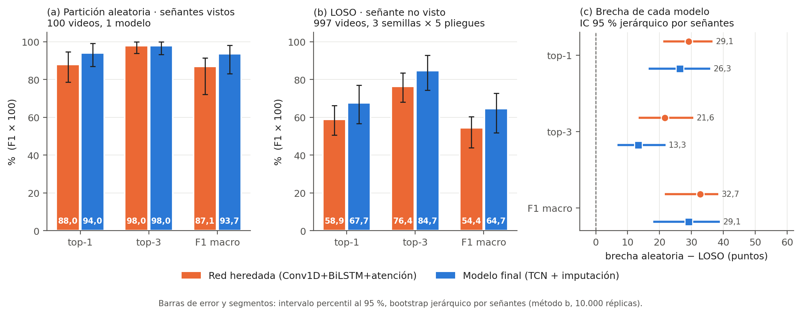
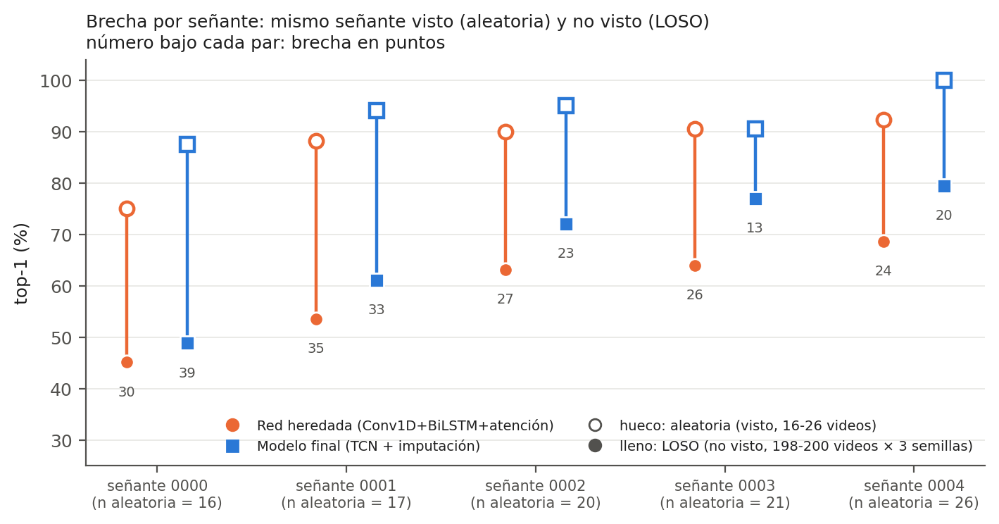
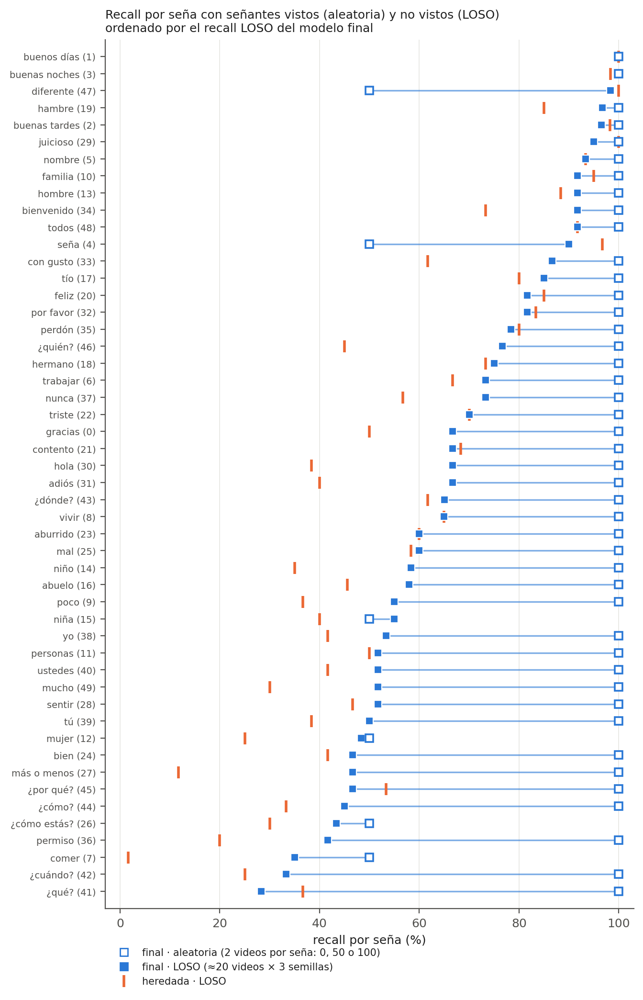

# Reporte comparativo del desempeño bajo los dos esquemas de partición, con el modelo final

**Actividad 4.e · Resultado esperado RE6 · 8-nov-2026 · versión vigente**

> **Qué sustituye.** Este documento sustituye, **como versión vigente**, a `docs/REPORTE_COMPARATIVO_4e.md` (N-44, 16-sep-2026). Aquel se escribió con la red heredada (Conv1D + BiLSTM + atención, 714.291 parámetros) y una sola semilla del LOSO. El director aprobó después como modelo final la TCN + imputación + 252 rasgos (D-14). El reporte del 16-sep **no se modifica** y queda como registro histórico. Sus secciones 3 a 8 (evolución D-05 → D-08, línea base de D-10, comparación con lo publicado, lo que no se podía reportar, amenazas a la validez) siguen siendo el registro de esa etapa. Aquí se rehace el núcleo de 4.e para **los dos modelos**: los dos esquemas, cada pliegue, la brecha y su discusión.
>
> **Qué es.** Un reporte sobre predicciones **ya guardadas**: no se entrenó ni se reevaluó ningún modelo y no se tomó ninguna decisión. Todas las cifras salen de `src/reporte_comparativo_4e_final.py`. El script las escribe en `docs/REPORTE_COMPARATIVO_4e_MODELO_FINAL.json` (se cita la clave) y genera las tres figuras de `docs/figuras_2026-11-08/` (prefijo `4e_`). Antes de calcular comprueba que las predicciones reproducen exactamente las métricas guardadas por cada entrenamiento (clave `controles_todo_coincide` = `true`).
>
> **Convenciones.** Coma decimal. Cifras en porcentaje o en puntos porcentuales (pp). «IC (a)» e «IC (b)» son intervalos percentil al 95 % con los dos métodos de §2.4. **Medido** marca lo que sale de un cálculo; **Lectura**, lo que es interpretación. Las rutas son relativas a la raíz del repositorio; las del anteproyecto, a `Anteproyecto/Anteproyecto_FINAL_LaTeX/`.

---

## 1. Qué pide el anteproyecto y con qué criterio se lee

- **RE6** (`10_resultados.tex:72-76`): un reporte comparativo del desempeño bajo la partición aleatoria a nivel de muestra y la partición independiente del señante, que «documenta la diferencia observada entre ambos esquemas y discute sus implicaciones sobre la capacidad de generalización del modelo».
- **Actividad 4.e** (`09_metodologia.tex:522-525`): además, «el reporte de cada pliegue de la validación cruzada con la condición del señante excluido».
- **§2.2.4** (`09_metodologia.tex:143-147`): con cinco señantes, LOSO de cinco pliegues; «se reportan la media y la dispersión entre pliegues». Los dos esquemas «se reportan por separado y nunca se presentan como equivalentes».
- **Por qué hay dos esquemas** (`09_metodologia.tex:340-347`): el desempeño con señantes vistos «puede descender de forma apreciable» con señantes no vistos. El anteproyecto **no cuantifica** esa caída y la remite a la medición del propio proyecto, que es este documento.
- **Sin umbral** (`09_metodologia.tex:352-357`; `08_marco.tex`, fila de exactitud: «No se fija umbral de aprobación»). Este documento no declara ninguna cifra suficiente o insuficiente.

Se mantiene el criterio del registro (N-25, N-30, N-31): **la cifra principal es la del LOSO**; la aleatoria es un contraste optimista.

---

## 2. Qué se compara

### 2.1 Modelos

| | Red heredada | Modelo final (D-14) |
|---|---|---|
| Arquitectura | Conv1D + BiLSTM + atención | TCN pequeña con GAP (4 bloques, dilataciones 1-2-4-8) |
| Mano ausente | «mascara» (D-07) | imputación lineal |
| Entrada | 30 pasos × 252 (126 posiciones + 126 velocidades) | igual |
| Parámetros | 714.291 | 156.402 |
| LOSO (3 semillas × 5 pliegues) | `models/experimento_mano_ausente_2026-10-02/A_mascara/` (brazo R0 de N-62) | `models/confirmacion_tcn_2026-10-03/T1_imputacion_252/` |
| Aleatoria (1 modelo, elegido por validación entre 5 semillas) | `models/canonico_holistic_mascara_manos/evaluacion_modelo_seleccionado/` (semilla 2026) | `models/tcn_imputacion/evaluacion_modelo_seleccionado/` (semilla 2030) |
| Umbral de operación | 0,20 (D-09) | 0,00 (N-65; aprobado, N-66) |

Fuente: clave `modelos` del JSON. Las cifras de este reporte son **sin umbral** (top-1 de la clase más probable). Con el umbral 0,00 del modelo final no cambia nada, porque no rechaza ninguna predicción.

### 2.2 Esquemas

| | Aleatoria 797/100/100 | LOSO, 5 pliegues |
|---|---|---|
| Qué separa | videos | señantes completos |
| Señante de la prueba | visto: los 5 están en entrenamiento | no visto: 1 por pliegue, ausente del entrenamiento |
| Entrenamiento | 797 videos | 697–699 por pliegue |
| Validación | 100 (2 por seña) | 100 por pliegue (2 por seña, **de los 4 señantes vistos**) |
| Prueba | 100 (2 por seña; 16–26 por señante) | 997 en total, 198–200 por pliegue |
| Modelos que dan la cifra | 1 | 15 (3 semillas × 5 pliegues) |

Fuentes: `data/partitions/aleatoria_80_10_10.json` y `data/partitions/loso_5_pliegues.json` (D-06). El reparto por señante de la prueba aleatoria está en la clave `aleatoria.<modelo>.por_senante`.

**Medido** (sobre `aleatoria_80_10_10.json`): de los 100 videos de prueba aleatoria, 58 tienen en el entrenamiento **3 repeticiones de la misma seña hechas por la misma persona**, 36 tienen 2 y 6 tienen 1. La partición aleatoria mide, sobre todo, si el modelo reconoce **otra repetición** de algo que ya vio hacer a esa persona.

### 2.3 Estadísticos

Son los mismos de N-62 a N-67 y del capítulo 5:
- **LOSO:** métrica de cada pliegue → media de los 5 pliegues → media de las 3 semillas. F1, precision y recall macro se calculan sobre las señas presentes en el pliegue (convención de sklearn).
- **Aleatoria:** un modelo sobre 100 videos.
- **Brecha** = aleatoria − LOSO del mismo modelo. **Diferencia** = final − heredada en el mismo esquema.
- El F1 principal del LOSO es la media entre pliegues (N-49). El agregado sobre los 997 videos es mayor: final 68,1, heredada 58,2 (clave `loso.<modelo>.agregado_997`).

### 2.4 Intervalos

Se usa el mismo método que `Documento_Tesis/scripts_figuras/c5_intervalos_confianza.py`, reimplementado en el script nuevo: 10.000 réplicas, percentil 2,5–97,5, semilla 20261108.

- **(a) Por videos**, estratificado por seña. Refleja solo la variación por muestreo de videos con estas cinco personas fijas. Es el intervalo **estrecho**.
- **(b) Jerárquico por señantes.** Se sacan 5 señantes con reemplazo y, dentro de cada uno, sus videos. Refleja la variación **entre personas**, que con cinco señantes es la dominante. Es el intervalo que responde a «¿cuánto acertaría con una persona nueva?».
- **Diferencia con el capítulo 5**, declarada en el script: en (b) se usa **la misma extracción de señantes** para el LOSO y para la aleatoria en cada réplica, para que la brecha quede pareada por persona. Las diferencias final − heredada son pareadas (mismos pesos para los dos modelos).
- Los intervalos **no incluyen la variación entre semillas**, que se da aparte: DE entre semillas de top-1 de 0,8 pp en la heredada y 1,7 pp en la final (clave `loso.<modelo>.top1.de_entre_semillas`).

---

## 3. Resultado principal: los dos modelos en los dos esquemas

**Medido.** Claves `intervalos.estadisticos` (`<modelo>|<esquema>|<métrica>`), `loso.<modelo>` y `aleatoria.<modelo>`.

| Modelo | Esquema | top-1 | top-3 | F1 macro | precision | recall |
|---|---|---|---|---|---|---|
| Heredada | Aleatoria (vistos) | **88,0** (a) [84,0; 92,0] (b) [78,7; 94,7] | 98,0 (b) [93,9; 100] | 87,1 | 89,7 | 88,0 |
| Heredada | LOSO (no visto) | **58,9** (a) [56,9; 61,0] (b) [50,6; 66,2] | 76,4 (b) [68,1; 83,6] | 54,4 (b) [43,9; 60,4] | 57,0 | 59,0 |
| **Final** | Aleatoria (vistos) | **94,0** (a) [91,0; 97,0] (b) [87,1; 99,1] | 98,0 (b) [93,2; 100] | 93,7 | 95,3 | 94,0 |
| **Final** | LOSO (no visto) | **67,7** (a) [65,7; 69,8] (b) [56,7; 77,1] | 84,7 (b) [74,3; 92,8] | 64,7 (b) [51,9; 72,7] | 69,2 | 67,7 |

Errores en la aleatoria: 12 de 100 (heredada) y 6 de 100 (final). Intervalos (a) de top-3 LOSO: heredada [74,6; 78,2], final [83,0; 86,2].

**Nota sobre los intervalos del F1.** El F1 macro baja en las réplicas que repiten videos. El sesgo medio de las réplicas es de −1,5 a −1,9 pp en el LOSO y de −2,5 a −4,6 pp en la aleatoria (claves `sesgo_a`, `sesgo_b`). Por eso el IC (a) del F1 LOSO queda casi entero por debajo del punto: final [61,4; 64,8] para 64,7. El JSON guarda también el intervalo con corrección de sesgo (BC): final LOSO (a) [64,5; 66,3], (b) [55,7; 74,5]. En la aleatoria, con 2 videos por seña, el F1 remuestreado no es fiable y aquí no se le da intervalo.



*Figura 1 (`4e_barras_esquemas_modelos.png`): (a) aleatoria, (b) LOSO, (c) brecha de cada modelo; intervalos (b).*

---

## 4. Cada pliegue, con el señante excluido

**Medido.** Media de las 3 semillas por pliegue; claves `loso.<modelo>.<métrica>.por_pliegue_media_semillas` y `validacion_top1`.

| Señante fuera | Modelo | top-1 | top-3 | precision | recall | F1 | validación top-1 | top-1 por semilla (2026/27/28) |
|---|---|---|---|---|---|---|---|---|
| 0000 (200) | heredada | 45,2 | 62,7 | 43,1 | 45,2 | 40,0 | 92,3 | 46,0 / 48,0 / 41,5 |
| | **final** | **48,8** | 66,0 | 55,7 | 48,8 | 46,9 | 96,0 | 54,0 / 39,0 / 53,5 |
| 0001 (199) | heredada | 53,6 | 71,5 | 50,5 | 53,8 | 47,2 | 89,3 | 53,3 / 49,2 / 58,3 |
| | **final** | **61,1** | 80,7 | 61,8 | 61,3 | 56,5 | 93,7 | 61,3 / 63,3 / 58,8 |
| 0002 (198) | heredada | 63,1 | 78,6 | 64,0 | 63,3 | 60,4 | 91,7 | 60,6 / 60,6 / 68,2 |
| | **final** | **72,1** | 88,9 | 71,5 | 72,1 | 68,5 | 93,7 | 71,7 / 69,7 / 74,7 |
| 0003 (200) | heredada | 64,0 | 82,7 | 61,1 | 64,0 | 60,3 | 95,0 | 61,5 / 65,0 / 65,5 |
| | **final** | **77,0** | 93,5 | 76,7 | 77,0 | 74,5 | 97,3 | 74,0 / 84,0 / 73,0 |
| 0004 (200) | heredada | 68,7 | 86,3 | 66,4 | 68,7 | 63,9 | 91,7 | 68,5 / 73,0 / 64,5 |
| | **final** | **79,5** | 94,2 | 80,4 | 79,5 | 77,0 | 94,0 | 83,0 / 73,0 / 82,5 |
| **Media** | heredada | 58,9 | 76,4 | 57,0 | 59,0 | 54,4 | 92,0 | 58,0 / 59,2 / 59,6 |
| | **final** | **67,7** | 84,7 | 69,2 | 67,7 | 64,7 | 94,9 | 68,8 / 65,8 / 68,5 |
| **DE entre pliegues** | heredada | 9,4 | 9,4 | 9,9 | 9,4 | 10,3 | 2,0 | — |
| | **final** | 12,7 | 11,7 | 10,3 | 12,7 | 12,7 | 1,7 | — |

Lo que estas cifras sostienen:

- **El orden de dificultad de los señantes es el mismo con los dos modelos** (0000 < 0001 < 0002 < 0003 < 0004).
- **El modelo final mejora a los cinco, pero mejora menos al más difícil:** +3,6 pp en 0000, +7,5 en 0001, +9,0 en 0002, +13,0 en 0003 y +10,8 en 0004 (restas de la tabla). Por eso la dispersión entre señantes **crece** (DE de 9,4 a 12,7 pp) y el rango pasa de 23,5 a 30,7 pp.
- **El señante 0000 es también el más inestable entre semillas** con el modelo final: 54,0 / 39,0 / 53,5. Una sola semilla podría haber dado para 0000 una cifra 15 pp distinta.
- **Sobre «la condición del señante excluido».** Como en N-44, el registro no tiene una caracterización de los cinco señantes (edad, condición auditiva, lateralidad, si es usuario nativo). Solo hay su identificador y las propiedades medidas de sus clips (`docs/REPORTE_COMPARATIVO_4e.md` §5.3). Este punto de 4.e sigue incompleto por la misma razón: la actividad 1.b no dejó esa información.

---

## 5. La brecha entre señantes vistos y no vistos

### 5.1 Global

**Medido.** Claves `intervalos.estadisticos.<modelo>|brecha|<métrica>` y `diferencia|brecha|<métrica>`.

| Brecha aleatoria − LOSO | Heredada | Final | Final − heredada |
|---|---|---|---|
| top-1 | **29,1** (a) [24,2; 33,8] (b) [21,1; 36,6] | **26,3** (a) [22,3; 30,3] (b) [16,6; 35,9] | −2,8 (a) [−7,1; +1,7] (b) [−11,3; +6,4] |
| top-3 | 21,6 (a) [18,9; 24,3] (b) [13,4; 30,6] | 13,3 (a) [10,8; 15,8] (b) [6,8; 21,9] | −8,3 (a) [−10,8; −5,7] (b) [−12,2; −3,9] |
| F1 macro | 32,7 (a) [27,4; 38,5] (b) [21,7; 38,4] | 29,1 (a) [25,3; 34,4] (b) [18,0; 38,9] | −3,6 (a) [−8,1; +2,3] (b) [−11,0; +9,4] |

Lo que sostienen:

- **La caída que el anteproyecto anticipaba existe y es grande con los dos modelos:** 26 a 29 pp de top-1. Ningún intervalo de la brecha se acerca a cero; el extremo inferior más bajo es 16,6 pp.
- **El modelo final no reduce de forma demostrable la brecha de top-1:** −2,8 pp, con un intervalo que incluye el cero con los dos métodos. Sube en los dos esquemas (+6,0 pp en la aleatoria y +8,8 en el LOSO, §7) y la distancia entre ambos queda prácticamente igual.
- **La brecha de top-3 sí se reduce (−8,3 pp, intervalos que excluyen el cero), pero es un efecto de techo.** Los dos modelos tienen top-3 aleatoria de 98,0 (2 fallos en 100), así que la reducción es casi entera la mejora del top-3 LOSO (+8,3 pp). No dice que el modelo final «generalice mejor» en un sentido distinto de «acierta más con personas nuevas».
- **Como proporción** (lectura descriptiva, sin intervalo): el LOSO conserva el 67 % del top-1 aleatorio con la heredada (58,9 / 88,0) y el 72 % con la final (67,7 / 94,0).

**Comparación con el reporte del 16-sep.** Allí la brecha era «0,88 − 0,580 = 30 puntos» (heredada, solo la semilla 2026). Con las tres semillas la heredada da 29,1. La diferencia es solo de base (1 frente a 3 semillas), no un error (§9).

### 5.2 Por señante

**Medido.** Clave `brecha_por_senante.<modelo>.<señante>`.
- «Aleatoria» es el top-1 sobre los videos de prueba aleatoria de ese señante (pocos: 16 a 26).
- «LOSO» es el top-1 con ese señante fuera (198-200 videos × 3 semillas).
- El IC de la brecha se obtiene remuestreando videos dentro del señante.
- La última columna es la exactitud de la **validación** LOSO del modelo final sobre los videos de ese señante cuando está entre los vistos (≈ 94-115 videos por semilla; clave `validacion_loso_final_por_senante`).

| Señante | Heredada: aleatoria → LOSO | brecha | Final: aleatoria → LOSO | brecha [IC por videos] | Final, validación LOSO (visto) |
|---|---|---|---|---|---|
| 0000 | 75,0 (12/16) → 45,2 | 29,8 | 87,5 (14/16) → 48,8 | **38,7** [20,2; 53,3] | 89,2 |
| 0001 | 88,2 (15/17) → 53,6 | 34,6 | 94,1 (16/17) → 61,1 | 33,0 [18,5; 43,4] | 94,2 |
| 0002 | 90,0 (18/20) → 63,1 | 26,9 | 95,0 (19/20) → 72,1 | 22,9 [10,5; 32,0] | 97,9 |
| 0003 | 90,5 (19/21) → 64,0 | 26,5 | 90,5 (19/21) → 77,0 | 13,5 [−1,8; 25,2] | 95,0 |
| 0004 | 92,3 (24/26) → 68,7 | 23,6 | 100 (26/26) → 79,5 | 20,5 [16,0; 25,5] | 98,3 |



*Figura 2 (`4e_brecha_por_senante.png`): hueco = aleatoria (visto), lleno = LOSO (no visto).*

Lo que sostienen y lo que no:

- **Medido:** con el modelo final la brecha baja en 0001 a 0004 y **sube en 0000** (de 29,8 a 38,7 pp). En 0000 la aleatoria sube 12,5 pp (2 videos más acertados de 16) y el LOSO solo 3,6.
- **Lectura:** la brecha por señante descansa en 16-26 videos aleatorios por persona. Sus intervalos miden de 15 a 33 pp de ancho y se solapan casi todos, así que no permite ordenar a los señantes por brecha.
- **Medido, y más firme:** el señante 0000 es el más bajo **también cuando es visto** (validación 89,2 frente a 94,2-98,3 de los demás).
- **Lectura:** parte de lo bajo de 0000 en el LOSO es que sus clips son más difíciles para el modelo en sí, no solo que sea una persona nueva. El reporte del 16-sep (§5.3) ya había medido propiedades de sus clips que lo distinguen, sin atribuir causa.

---

## 6. Por seña: qué señas caen más al pasar a señantes no vistos

**Medido.** Clave `por_clase`.
- El recall aleatoria sale de 2 videos por seña, así que solo puede valer 0, 50 o 100.
- El recall LOSO sale de ≈20 videos por seña, media de 3 semillas.
- Caída = aleatoria − LOSO.

**Las 10 señas con mayor caída en el modelo final** (`por_clase.mayor_caida_final_10`):

| Seña (id) | Final: aleatoria → LOSO | caída | Heredada: aleatoria → LOSO | Final, validación LOSO (visto) |
|---|---|---|---|---|
| ¿qué? (41) | 100 → 28,3 | 71,7 | 50 → 36,7 | 96,7 |
| ¿cuándo? (42) | 100 → 33,3 | 66,7 | 50 → 25,0 | 96,7 |
| permiso (36) | 100 → 41,7 | 58,3 | 100 → 20,0 | 96,7 |
| ¿cómo? (44) | 100 → 45,0 | 55,0 | 0 → 33,3 | 80,0 |
| más o menos (27) | 100 → 46,7 | 53,3 | 100 → 11,7 | 100 |
| ¿por qué? (45) | 100 → 46,7 | 53,3 | 100 → 53,3 | 100 |
| bien (24) | 100 → 46,7 | 53,3 | 100 → 41,7 | 100 |
| tú (39) | 100 → 50,0 | 50,0 | 100 → 38,3 | 100 |
| sentir (28) | 100 → 51,7 | 48,3 | 100 → 46,7 | 100 |
| personas (11) | 100 → 51,7 | 48,3 | 100 → 50,0 | 100 |

Recall LOSO más bajo del modelo final fuera de esa lista: comer (7) 35,0; ¿cómo estás? (26) 43,3; mujer (12) 48,3. En estas tres la aleatoria ya fallaba uno de los dos videos.

**Por grupo de N-30** (media del recall de las señas del grupo; clave `por_clase.por_grupo_n30`):

| Grupo (n señas) | Heredada: aleatoria → LOSO (caída) | Final: aleatoria → LOSO (caída) |
|---|---|---|
| interrogativos (7) | 71,4 → 40,7 (30,7) | 92,9 → **48,3** (**44,5**) |
| valoración: bien / mal / más o menos (3) | 83,3 → 37,2 (46,1) | 100 → **51,1** (48,9) |
| emociones (4) | 87,5 → 70,8 (16,7) | 100 → 69,6 (30,4) |
| resto (36) | 91,7 → 63,0 (28,7) | 93,1 → **72,7** (20,4) |

Resumen (claves `por_clase.resumen_<modelo>` y `final_vs_heredado_loso`):

- **Señas con recall LOSO < 50 %:** 21 con la heredada y 10 con la final. Con recall ≥ 90 %: 9 y 12.
- **Final frente a heredada:** el recall LOSO mejora en 33 señas, empeora en 11 y queda igual en 6. Las mayores bajadas son ¿qué? (36,7 → 28,3) y ¿por qué? (53,3 → 46,7).
- **Las señas difíciles son casi las mismas con los dos modelos:** Spearman 0,91 entre sus recall LOSO. Siete de las 10 peores coinciden: comer, mujer, ¿cómo estás?, más o menos, permiso, ¿cuándo?, ¿cómo?.
- **Control de robustez** (solo modelo final): si la referencia de «señante visto» es la validación LOSO (≈10 videos por seña y semilla) en lugar de los 2 videos aleatorios, la caída por seña tiene Spearman 0,84 con la de la tabla. Nueve de las 10 señas de mayor caída coinciden (`por_clase.control_caida_con_validacion_final`).
- **Ruido de 2 videos:** en la aleatoria hay señas con caída negativa (seña, diferente, niña) solo porque uno de sus dos videos falló. No indican nada de la seña.



*Figura 3 (`4e_recall_por_clase_aleatoria_vs_loso.png`): 50 señas ordenadas por el recall LOSO del modelo final; hueco = aleatoria, lleno = LOSO, raya naranja = LOSO de la heredada.*

**Lectura (hipótesis, no medida).**
- La mayor caída se concentra en los interrogativos y en bien / mal / más o menos. En el modelo final la caída de los interrogativos **creció** (de 30,7 a 44,5 pp) aunque su recall LOSO subió.
- En la LSC los interrogativos y las valoraciones se apoyan en rasgos no manuales (Oviedo 2001, `ref13`), y la entrada de los dos modelos solo lleva las manos (D-08).
- Una explicación compatible: sin rasgos no manuales, el modelo distingue estas señas por detalles manuales propios de cada persona, que aprende con los señantes vistos y no transfiere.
- Este reporte no lo prueba. D-08 midió con la heredada que añadir postura y rostro **no** mejoró el LOSO.
- Las confusiones concretas (qué se confunde con qué) son materia del análisis de errores 4.d con el modelo final, que se elabora aparte.

---

## 7. Diferencia entre el modelo final y la heredada en cada esquema

**Medido.** Claves `intervalos.estadisticos.diferencia|...` y `mcnemar`.

| Final − heredada | top-1 | top-3 | F1 macro |
|---|---|---|---|
| LOSO | **+8,8** (a) [+6,9; +10,7] (b) [+5,2; +12,1] | +8,3 (a) [+6,6; +10,0] (b) [+5,1; +11,0] | +10,3 (a) [+8,5; +11,9] (b) [+7,0; +13,3] |
| Aleatoria | +6,0 (a) [+2,0; +10,0] (b) [−1,0; +13,5] | 0,0 (a) [−2,0; +2,0] (b) [−4,5; +3,7] | +6,7 (sin intervalo, §3) |

- **LOSO:** la mejora es clara con los dos métodos. McNemar con el voto de las 3 semillas (997 videos): 163 videos los acierta solo el final y 56 solo la heredada, p exacto = 2,6·10⁻¹³. Por semilla, p entre 4·10⁻¹² y 2·10⁻⁵ (`mcnemar.loso_por_semilla`). Es **descriptivo**: trata como independientes videos de solo 5 personas. La cifra que tiene en cuenta a las personas es el IC (b).
- **Aleatoria:** +6,0 pp. El IC (b) cruza el cero; el IC (a) no. McNemar sobre los 100 videos: 8 frente a 2, p = 0,11 (`mcnemar.aleatoria`). Con 100 videos, 1 pp es 1 video.
- **Lectura:** la ventaja del modelo final es más firme justo donde importa (personas nuevas) que en el esquema que el anteproyecto declara optimista. Era esperable: con 100 videos y casi todo acertado, la aleatoria tiene poco margen para separar dos modelos.

---

## 8. Por qué la validación del LOSO está saturada y qué implica

**Medido** (claves `loso.<modelo>.validacion_top1` y `validacion_menos_prueba_top1`):

| | Heredada | Final |
|---|---|---|
| Validación top-1, media de 15 corridas | 92,0 | 94,9 |
| Rango de las 15 corridas | 88–96 | 92–98 (solo 6 valores distintos) |
| DE entre pliegues: validación / prueba | 2,0 / 9,4 | 1,7 / 12,7 |
| Validación − prueba, media | 33,1 | 27,2 |
| Validación − prueba, pliegue a pliegue | 47,2 / 35,7 / 28,5 / 31,0 / 23,0 | 47,2 / 32,5 / 21,6 / 20,3 / 14,5 |
| Prueba aleatoria (también señantes vistos) | 88,0 | 94,0 |

**Por qué está saturada.**
- La validación de cada pliegue son 100 videos (2 por seña) de los **cuatro señantes que sí están en el entrenamiento** (D-06).
- Por eso mide lo mismo que la partición aleatoria (reconocer otra repetición de una persona ya vista) y da cifras parecidas a la prueba aleatoria: 94,9 frente a 94,0 en el final; 92,0 frente a 88,0 en la heredada.
- Ahí los dos modelos están cerca del techo: con 100 videos, cada video vale 1 pp y la validación se mueve en una franja de pocos videos.

**Qué implica.**
1. **La validación casi no distingue modelos que en prueba sí se distinguen:** final − heredada es +2,9 pp en validación y +8,8 pp en prueba LOSO. Ya pasó en la selección: el factorial (N-63) tuvo que desempatar con `val_loss` porque la exactitud de validación empataba (~0,95).
2. **No anticipa la cifra con personas nuevas:** la distancia entre validación y prueba va de 14,5 a 47,2 pp según el señante, y la validación no ve esa dispersión (DE 1,7 frente a 12,7).
3. **Todo lo que se elige por validación se elige con señal de señantes vistos.** Eso incluye la parada temprana, el punto de control, la configuración entre las de N-62 a N-64 y el umbral de operación (0,00 se calibró con la validación del LOSO, N-65). Una elección que solo ayude a reconocer a personas ya vistas no se distingue, en validación, de una que ayude a las nuevas. N-47 propuso la validación anidada por señante para el umbral de la heredada; D-14 deja pendiente rehacerla con el modelo final.
4. **No invalida las cifras de prueba:** la prueba LOSO nunca se usó para elegir (N-62, N-63). Lo que se limita es la capacidad de elegir bien, no la honestidad de la medición. La salida correcta (validar con un señante de los cuatro de entrenamiento) cuesta datos de entrenamiento y queda como trabajo futuro, como ya se dijo en N-30 y D-09.

---

## 9. Cotejo con las cifras conocidas y discrepancias

**Ninguna cifra conocida difiere** (clave `cifras_conocidas`, todas `coincide` = `true`):
- LOSO final 67,7 / 84,7 / 0,647, señante 0000 48,8; aleatoria final 94, F1 0,937.
- LOSO heredada 58,9 / 76,4 / 0,544, señante 0000 45,2; aleatoria heredada 88.
- IC (b): final [56,7; 77,1] (conocido [57,1; 77,0]); heredada [50,6; 66,2] (conocido [50,9; 66,1]); diferencia [+5,2; +12,1] (conocido [+5,3; +12,1]).
- McNemar 163 / 56, p = 2,6·10⁻¹³.

Las predicciones reproducen exactamente las métricas guardadas por cada corrida (diferencia máxima 0) y el McNemar guardado en `resultados_confirmacion_tcn.json`. Contra el script del capítulo 5 (`cotejo_capitulo_5`), las estimaciones puntuales son idénticas. Los extremos de los intervalos difieren hasta 0,38 pp, que es ruido de Monte Carlo: otra secuencia aleatoria y, en (b), la extracción de señantes compartida entre esquemas.

Cosas que **no son errores** pero conviene no mezclar:
1. **La heredada del reporte del 16-sep no es la misma cifra que la de aquí.** Allí: LOSO 0,580 ± 0,086, F1 0,537, validación 0,932, brecha «30 puntos» (solo la semilla 2026, `models/loso_2026-09-15_holistic_mascara_manos`). Aquí: 58,9, F1 54,4, validación 92,0, brecha 29,1 (media de 3 semillas). La semilla 2026 del brazo A_mascara reproduce exactamente aquella (58,0; N-62, `verificacion`). Para comparar con el modelo final debe usarse la de 3 semillas.
2. **«La diferencia en la aleatoria cruza el cero» depende del método.** Es cierto con el IC (b) [−1,0; +13,5] (capítulo 5: [−1,0; +13,2]); con el IC (a) es [+2,0; +10,0] y no lo cruza. Lo correcto es decir que la aleatoria no permite afirmar la mejora **para personas en general**, no que no haya diferencia en estos 100 videos.
3. **El IC (a) del F1 LOSO está sesgado hacia abajo** (§3): [61,4; 64,8] para un punto de 64,7. Viene del mismo método del capítulo 5 (también allí [61,4; 64,8]); conviene citar el IC (b) o el BC.
4. **F1 0,647 es la media entre pliegues** (N-49). El F1 agregado sobre los 997 videos es 0,681; no deben citarse como la misma cifra.

---

## 10. Interpretación: qué dice la brecha sobre la generalización a personas nuevas

1. **Con señantes nuevos, el modelo final acierta en primera opción alrededor de dos de cada tres señas** (67,7 %), y la seña correcta está entre las tres primeras en el 84,7 %. Con cinco personas, la incertidumbre por persona es ancha: entre 56,7 y 77,1 % (IC b). En la práctica la cifra va de 48,8 % (0000) a 79,5 % (0004). **Ese rango, no el 94 %, es lo que cabe esperar con una persona nueva parecida a las del corpus.**
2. **La partición aleatoria sobrestima en unos 26 pp de top-1** lo que el modelo hace con una persona nueva. La razón medible es que casi todos sus videos de prueba tienen 2 o 3 repeticiones de la misma seña por la misma persona en el entrenamiento (§2.2). Por eso el 94 % no debe citarse como exactitud del prototipo.
3. **La mejora del modelo final es real con personas nuevas** (+8,8 pp, IC b [+5,2; +12,1]) **pero no cierra la brecha.** El modelo acierta más en los dos esquemas y la distancia entre ellos queda igual dentro de la precisión que permiten cinco señantes; además, mejora menos al señante más difícil. La parte de la generalización que depende de la persona sigue siendo, sobre todo, un asunto de **datos** (cinco señantes, 4 repeticiones por seña) antes que de arquitectura. El reporte del 16-sep (§4.5) ya había mostrado que la brecha la tienen también los clasificadores clásicos.
4. **Las señas que más dependen de la persona son identificables** (interrogativos, valoraciones, permiso, tú, comer, mujer) y son casi las mismas con las dos arquitecturas. Eso apunta a la entrada o a los datos más que al modelo (§6, hipótesis).
5. **Lo que no se puede afirmar:**
   - nada sobre personas con un perfil distinto al de los cinco señantes (edad, región, fluidez; LSC50 declara señantes no nativos, `09_metodologia.tex:242-244`);
   - nada sobre el uso en vivo (otra cámara, otra luz, señas sin recortar; N-57 midió −4 pp solo por el formato 4:3);
   - nada sobre la LSC en general a partir de 50 señas aisladas.

---

## 11. ¿Se cumple el resultado esperado RE6?

| Lo que pide el anteproyecto | Estado |
|---|---|
| Desempeño bajo los dos esquemas, reportado por separado (RE6; `09_metodologia.tex:145-147`) | **Cumplido**: §3, con los dos modelos, sin presentarlos como equivalentes |
| Documentar la diferencia observada (RE6) | **Cumplido**: §5, con intervalo por videos y por señantes, global, por señante y por seña |
| Discutir sus implicaciones sobre la generalización (RE6) | **Cumplido**: §8 y §10 |
| Cada pliegue de la validación cruzada (4.e) | **Cumplido**: §4, con media y dispersión entre pliegues |
| «Con la condición del señante excluido» (4.e) | **Parcial**: solo identificador y propiedades medidas de los clips; falta la caracterización de las personas (1.b) |
| La caída «apreciable» que motivó el doble esquema (`09_metodologia.tex:340-347`) | **Observada**: 26,3 pp de top-1 en el modelo final (IC b [16,6; 35,9]) y 29,1 en la heredada |

No hay umbral que cumplir: el anteproyecto compromete el rigor de la medición, no una cifra. Con este documento, RE6 queda cubierto en todo lo que depende de los datos guardados. Lo único abierto es la caracterización de los señantes, que no depende de ningún cálculo.

---

## 12. Límites de este reporte

1. **Cinco señantes.** Todo intervalo «por personas» se apoya en cinco personas. El IC (b) es la mejor aproximación disponible, no una garantía.
2. **La aleatoria es un solo modelo elegido entre cinco semillas por validación** (2026 en la heredada, 2030 en la final), sin guardar la prueba de las otras cuatro. El LOSO es la media de 15 modelos sin selección. La brecha mezcla «visto / no visto» con «1 modelo seleccionado / media de 15». Hacer las dos comparables exigiría evaluar las 5 semillas aleatorias; no se hizo para no reevaluar modelos.
3. **Entrenamientos de tamaño distinto:** 797 frente a 697-699 videos (~14 % más en la aleatoria). Una parte de la brecha puede venir de ahí; con estos datos no se puede separar.
4. **Los intervalos no incluyen la variación entre semillas:** DE de 0,8-1,7 pp en top-1 del LOSO, y hasta 15 pp en el señante 0000 del modelo final.
5. **Recall por seña en la aleatoria con 2 videos:** solo sirve para ordenar de forma gruesa. El control con la validación (§6) lo respalda, pero ninguna seña concreta debe citarse por su caída aleatoria sin ese matiz.
6. **Sin umbral:** las cifras son top-1 sin rechazo. Con el umbral 0,00 del modelo final coinciden; con el 0,20 de la heredada no se recalcularon aquí.
7. **Fuera de alcance de esta versión:** la línea base clásica (2.c), la comparación con lo publicado y la latencia (4.c) no se rehacen aquí; las confusiones por seña son de 4.d.

---

## 13. Reproducción y fuentes

```
python src/reporte_comparativo_4e_final.py
python -m unittest tests.test_reporte_comparativo_4e_final -v
```

Tarda unos 10 s y es determinista (semillas 20261108 y 20261109). Hay 17 pruebas: funciones puras con cálculos a mano y contra sklearn, y una corrida corta sobre los datos reales que debe reproducir las cifras guardadas.

| Qué | Archivo |
|---|---|
| Predicciones LOSO, final | `models/confirmacion_tcn_2026-10-03/T1_imputacion_252/semilla_{2026,2027,2028}/pliegue_{0..4}/` (`predicciones.json`, `resultado.json`, `probabilidades.npz`) |
| Predicciones LOSO, heredada | `models/experimento_mano_ausente_2026-10-02/A_mascara/semilla_{2026,2027,2028}/pliegue_{0..4}/` (`predicciones.json`, `metricas.json`) |
| Prueba aleatoria | `models/tcn_imputacion/evaluacion_modelo_seleccionado/` y `models/canonico_holistic_mascara_manos/evaluacion_modelo_seleccionado/` |
| McNemar guardado (control) | `models/confirmacion_tcn_2026-10-03/resultados_confirmacion_tcn.json`, `mcnemar.T1_vs_R0.voto_3_semillas` |
| Particiones | `data/partitions/aleatoria_80_10_10.json`, `data/partitions/loso_5_pliegues.json` |
| Cifras y figuras de este reporte | `docs/REPORTE_COMPARATIVO_4e_MODELO_FINAL.json`, `docs/figuras_2026-11-08/4e_*.png` |
| Registro | N-44 (reporte anterior), N-49 (F1), N-62 a N-65, D-14, N-66 |
